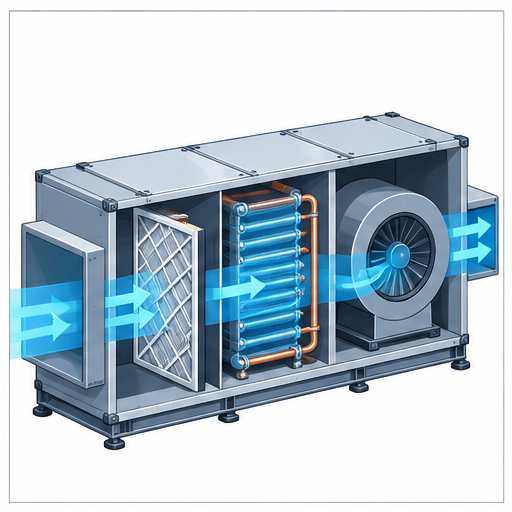

# 先看懂一台 AHU

基礎 / ahu

## 學習目標
- 能用自己的話說明「先看懂一台 AHU」的主要角色或資料關係。
- 能辨認本課常見誤解，並說明應查驗的資料或證據。

## 前置能力
先理解 FMCS 的資料流與監控分工。

## 原教材重點
- AHU 是空調箱，負責處理並輸送空氣。本案例以記憶體廠的空調服務區域為背景，先學一台設備。
- AHU 處理及輸送空氣，常包含濾網、盤管與風機。

## 圖文對照

先找風機、濾網及溫度等量測位置，再回到本課的點位與狀態。圖為教材概念插圖。

## 常見問題
### 這一課應先掌握什麼？
AHU 是空調箱，負責處理並輸送空氣。本案例以記憶體廠的空調服務區域為背景，先學一台設備。

### AHU 在本教材代表哪類設備？
空氣處理機或空調箱。AHU 處理及輸送空氣，常包含濾網、盤管與風機。

### 送風溫度與回風溫度應如何建點？
分成不同點位並各自標明單位與位置。量測位置不同就代表不同物理意義，點位表須分別描述。

## 記憶卡
- 問：風機收到啟動命令後，能否直接當作已運轉？
  答：還要核對運轉回授。命令是要求，回授才是實際狀態，兩者需分開呈現。
- 問：濾網壓差資料的用途為何？
  答：協助判讀濾網與氣流狀況。壓差是設備狀態的線索，門檻與保養決策仍依工程規格及現場程序。
- 問：兩台 AHU 使用共用圖形時，最應核對什麼？
  答：各自的設備參照與資料來源。共用外觀可重用，但設備實例與來源參照必須保持獨立。

## 實作與學習紀錄
以本課原教材的案例，記錄一項正常情境與一項異常情境，分別寫下預期結果、實際證據及待確認事項。

- 我的說明：
- 預期與實際結果：
- 待確認問題：

## 課後五題測驗

1. 下列哪項符合本課的教材重點？
   A. AHU 是空調箱，負責處理並輸送空氣。本案例以記憶體廠的空調服務區域為背景，先學一台設備。
   B. 電力計費軟體
   C. 資料庫備份工具

2. 複習本課的操作與判讀原則，哪一項正確？
   A. 共用同一個值即可
   B. AHU 處理及輸送空氣，常包含濾網、盤管與風機。
   C. 由畫面顏色自動推算

3. 濾網壓差資料的用途為何？
   A. 證明資料庫一定正常
   B. 直接取代所有保養判斷
   C. 協助判讀濾網與氣流狀況

4. 送風溫度與回風溫度應如何建點？
   A. 共用同一個值即可
   B. 分成不同點位並各自標明單位與位置
   C. 由畫面顏色自動推算

5. AHU 在本教材代表哪類設備？
   A. 電力計費軟體
   B. 資料庫備份工具
   C. 空氣處理機或空調箱

## 答案與解析
1. A：本課原教材重點：AHU 是空調箱，負責處理並輸送空氣。本案例以記憶體廠的空調服務區域為背景，先學一台設備。
2. B：本課原教材重點：AHU 處理及輸送空氣，常包含濾網、盤管與風機。
3. C：壓差是設備狀態的線索，門檻與保養決策仍依工程規格及現場程序。
4. B：量測位置不同就代表不同物理意義，點位表須分別描述。
5. C：AHU 處理及輸送空氣，常包含濾網、盤管與風機。

## 原教材
https://chermanyen.github.io/fmcs-academy/courses/ahu/index.html#topic-2
概念與練習沿用本站原教材；版本、來源圖及限制仍以原教材標示為準。
