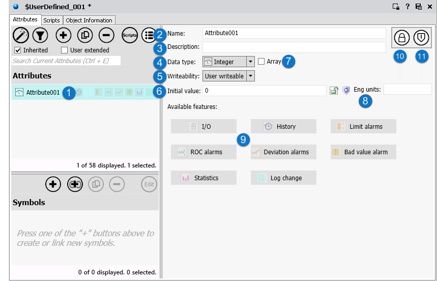

# 步驟 1：準備 PLC 點位表

基礎 / ahu

## 學習目標
- 能用自己的話說明「步驟 1：準備 PLC 點位表」的主要角色或資料關係。
- 能辨認本課常見誤解，並說明應查驗的資料或證據。

## 前置能力
先理解 FMCS 的資料流與監控分工。

## 原教材重點
- 點位表像 API 規格，先約定名稱、型別、方向與工程單位。
- SupplyTemp／Float／讀取／°C
- RoomTemp／Float／讀取／°C
- FanRunning、FanFault／Boolean／讀取
- FilterDP／Float／讀取／Pa
- StartRequest／Boolean／寫入

## 圖文對照

沿用相關教材畫面輔助辨認本課角色與設定位置，非本課的實測結果；介面及欄位依版本不同。

## 常見問題
### 這一課應先掌握什麼？
點位表像 API 規格，先約定名稱、型別、方向與工程單位。

### 設計溫度 Attribute 時，除了名稱還要定義什麼？
型別、單位、來源、範圍與讀寫方向。屬性定義需足以支援採集、畫面、警報及驗收。

### 外部輸入與衍生計算值應如何區分？
記錄各自來源及計算規則。區分原始輸入與衍生值，才能追查縮放或計算問題。

## 記憶卡
- 問：點位命名應優先滿足哪項需求？
  答：能辨認設備、用途並符合專案規範。命名需支援定位及維護，還要搭配完整點位規格。
- 問：只改屬性名稱，畫面資料綁定會一定正確嗎？
  答：還需檢查引用及部署影響。依名稱建立的引用可能受變更影響，應列入回歸驗收。
- 問：狀態值與控制命令為何要分開建欄位？
  答：命令是要求，狀態是實際回授。責任分清可避免操作人員把發令成功誤判成設備已動作。

## 實作與學習紀錄
以本課原教材的案例，記錄一項正常情境與一項異常情境，分別寫下預期結果、實際證據及待確認事項。

- 我的說明：
- 預期與實際結果：
- 待確認問題：

## 課後五題測驗

1. 下列哪項符合本課的教材重點？
   A. 只定義文字顏色
   B. 只填維護人姓名
   C. 點位表像 API 規格，先約定名稱、型別、方向與工程單位。

2. 複習本課的操作與判讀原則，哪一項正確？
   A. SupplyTemp／Float／讀取／°C
   B. 全部用同一名稱覆蓋
   C. 一律不保留來源

3. 外部輸入與衍生計算值應如何區分？
   A. 全部用同一名稱覆蓋
   B. 一律不保留來源
   C. 記錄各自來源及計算規則

4. 設計溫度 Attribute 時，除了名稱還要定義什麼？
   A. 型別、單位、來源、範圍與讀寫方向
   B. 只填維護人姓名
   C. 只定義文字顏色

5. 只改屬性名稱，畫面資料綁定會一定正確嗎？
   A. 名稱相似就會自動正確
   B. 還需檢查引用及部署影響
   C. 畫面標題會自動代替參照

## 答案與解析
1. C：本課原教材重點：點位表像 API 規格，先約定名稱、型別、方向與工程單位。
2. A：本課原教材重點：SupplyTemp／Float／讀取／°C
3. C：區分原始輸入與衍生值，才能追查縮放或計算問題。
4. A：屬性定義需足以支援採集、畫面、警報及驗收。
5. B：依名稱建立的引用可能受變更影響，應列入回歸驗收。

## 原教材
https://chermanyen.github.io/fmcs-academy/courses/ahu/index.html#topic-4
概念與練習沿用本站原教材；版本、來源圖及限制仍以原教材標示為準。
