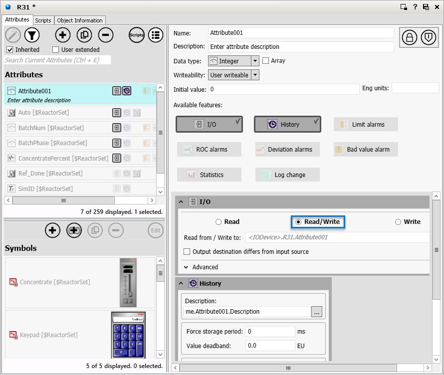

# 步驟 4：接上通訊與 I/O

基礎 / ahu

## 學習目標
- 能用自己的話說明「步驟 4：接上通訊與 I/O」的主要角色或資料關係。
- 能辨認本課常見誤解，並說明應查驗的資料或證據。

## 前置能力
先理解 FMCS 的資料流與監控分工。

## 原教材重點
- 先證明 OI Server 能讀 PLC，再設定設備 Attribute 的輸入參照。
- OI Server：設定裝置與通訊群組
- PLC_Client：設定 Server、Topic 等適用欄位
- AHU_001：將各屬性對應點位
- Validate、Check-in，部署所需物件
- Object Viewer：比對數值、時間與品質

## 圖文對照

沿用相關教材畫面輔助辨認本課角色與設定位置，非本課的實測結果；介面及欄位依版本不同。

## 常見問題
### 這一課應先掌握什麼？
先證明 OI Server 能讀 PLC，再設定設備 Attribute 的輸入參照。

### Boolean 點位最適合表示哪種資料？
運轉與停止等兩態狀態。Boolean 表示兩種邏輯狀態，連續量測需選適合的數值型別。

### 類比量從原始值轉成工程值時應注意什麼？
型別、單位與縮放只在規劃的一層處理。重複縮放會產生錯誤，需明確記錄原始範圍與工程範圍。

## 記憶卡
- 問：同樣顯示 0 的兩個點位可以直接視為相同狀態嗎？
  答：需核對品質、型別與物理意義。0 可能是正常量測、停止回授或預設值，不能脫離上下文判讀。
- 問：點位表至少應說明哪種關係？
  答：來源位址與目標欄位、型別、單位的對應。映射資訊讓採集、建模與驗收能以同一規格核對。
- 問：讀取點與寫入點應如何處理？
  答：清楚區分方向並依權限及連鎖規劃。命令寫入可能影響設備，方向與操作條件必須由核准規格決定。

## 實作與學習紀錄
以本課原教材的案例，記錄一項正常情境與一項異常情境，分別寫下預期結果、實際證據及待確認事項。

- 我的說明：
- 預期與實際結果：
- 待確認問題：

## 課後五題測驗

1. 下列哪項符合本課的教材重點？
   A. 連續溫度小數
   B. 先證明 OI Server 能讀 PLC，再設定設備 Attribute 的輸入參照。
   C. 完整歷史曲線

2. 複習本課的操作與判讀原則，哪一項正確？
   A. 每一層都重複縮放
   B. 單位文字會自動改變數值
   C. OI Server：設定裝置與通訊群組

3. Boolean 點位最適合表示哪種資料？
   A. 運轉與停止等兩態狀態
   B. 完整歷史曲線
   C. 連續溫度小數

4. 讀取點與寫入點應如何處理？
   A. 看到值就可任意寫入
   B. 清楚區分方向並依權限及連鎖規劃
   C. 所有點都預設雙向

5. 類比量從原始值轉成工程值時應注意什麼？
   A. 單位文字會自動改變數值
   B. 每一層都重複縮放
   C. 型別、單位與縮放只在規劃的一層處理

## 答案與解析
1. B：本課原教材重點：先證明 OI Server 能讀 PLC，再設定設備 Attribute 的輸入參照。
2. C：本課原教材重點：OI Server：設定裝置與通訊群組
3. A：Boolean 表示兩種邏輯狀態，連續量測需選適合的數值型別。
4. B：命令寫入可能影響設備，方向與操作條件必須由核准規格決定。
5. C：重複縮放會產生錯誤，需明確記錄原始範圍與工程範圍。

## 原教材
https://chermanyen.github.io/fmcs-academy/courses/ahu/index.html#topic-7
概念與練習沿用本站原教材；版本、來源圖及限制仍以原教材標示為準。
