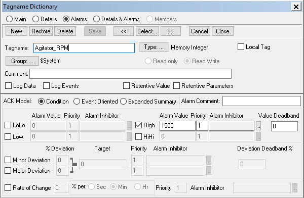

# 步驟 6：設定高溫警報

基礎 / ahu

## 學習目標
- 能用自己的話說明「步驟 6：設定高溫警報」的主要角色或資料關係。
- 能辨認本課常見誤解，並說明應查驗的資料或證據。

## 前置能力
先理解 FMCS 的資料流與監控分工。

## 原教材重點
- 教學條件：溫度高於 25°C 持續 30 秒發報，回到 24.5°C 以下恢復。
- 在 RoomTemp 配置適用的高限警報
- 加入警報清單並驗證發生、確認及恢復
- 警報確認表示人員已知悉，不等於異常消失

## 圖文對照

沿用相關教材畫面輔助辨認本課角色與設定位置，非本課的實測結果；介面及欄位依版本不同。

## 常見問題
### 這一課應先掌握什麼？
教學條件：溫度高於 25°C 持續 30 秒發報，回到 24.5°C 以下恢復。

### 警報確認與警報恢復的差別為何？
確認表示已知悉，恢復表示條件解除。人的確認與設備條件是兩個維度，驗收應分開測試。

### 警報延遲的用途為何？
避免短暫波動立即觸發特定警報。延遲需依設備風險與規格設定，並測試持續時間的行為。

## 記憶卡
- 問：遲滯或死區可協助處理什麼問題？
  答：測值在門檻附近反覆觸發與恢復。觸發與恢復條件分開，可減少門檻附近的反覆變化。
- 問：處理警報時，較好的第一步是什麼？
  答：確認點位、時間、品質及相關趨勢。先建立上下文，再依分級與現場程序處置。
- 問：高溫警報與通訊失效應如何呈現？
  答：區分量測異常與資料無效。來源不可信時不能據此斷言設備溫度正常或異常。

## 實作與學習紀錄
以本課原教材的案例，記錄一項正常情境與一項異常情境，分別寫下預期結果、實際證據及待確認事項。

- 我的說明：
- 預期與實際結果：
- 待確認問題：

## 課後五題測驗

1. 下列哪項符合本課的教材重點？
   A. 教學條件：溫度高於 25°C 持續 30 秒發報，回到 24.5°C 以下恢復。
   B. 確認就代表設備已修好
   C. 恢復會自動證明有人知悉

2. 複習本課的操作與判讀原則，哪一項正確？
   A. 自動修復所有通訊
   B. 在 RoomTemp 配置適用的高限警報
   C. 保證永不發生故障

3. 警報延遲的用途為何？
   A. 避免短暫波動立即觸發特定警報
   B. 保證永不發生故障
   C. 自動修復所有通訊

4. 處理警報時，較好的第一步是什麼？
   A. 直接提高門檻讓它消失
   B. 確認點位、時間、品質及相關趨勢
   C. 先將全部設備重啟

5. 高溫警報與通訊失效應如何呈現？
   A. 通訊失效一律填正常溫度
   B. 區分量測異常與資料無效
   C. 都當成同一種溫度值

## 答案與解析
1. A：本課原教材重點：教學條件：溫度高於 25°C 持續 30 秒發報，回到 24.5°C 以下恢復。
2. B：本課原教材重點：在 RoomTemp 配置適用的高限警報
3. A：延遲需依設備風險與規格設定，並測試持續時間的行為。
4. B：先建立上下文，再依分級與現場程序處置。
5. B：來源不可信時不能據此斷言設備溫度正常或異常。

## 原教材
https://chermanyen.github.io/fmcs-academy/courses/ahu/index.html#topic-9
概念與練習沿用本站原教材；版本、來源圖及限制仍以原教材標示為準。
