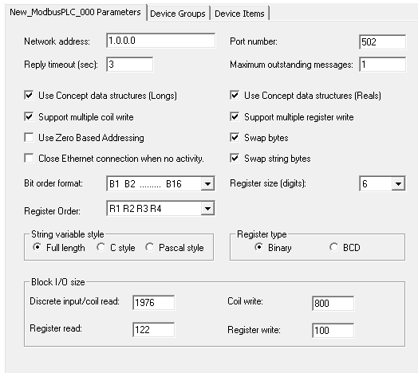

# 第 5 週｜Modbus TCP／RTU 設備通訊

基礎 / foundation

## 學習目標
- 能用自己的話說明「第 5 週｜Modbus TCP／RTU 設備通訊」的主要角色或資料關係。
- 能辨認本課常見誤解，並說明應查驗的資料或證據。

## 前置能力
先理解 FMCS 的資料流與監控分工。

## 原教材重點
- 認識 Client／Server、Coil、Holding Register，以及 TCP 網路與 RTU 串列通訊的差異。
- 依設備點表整理 IP／Port 或串列參數、Unit ID、功能碼、位址、型別及縮放；規劃唯讀測試。
- 確認 0-based 位址、字組順序與原廠點表；不要把文件 4xxxx 編號直接當作程式位址。

## 圖文對照

沿用相關教材畫面輔助辨認本課角色與設定位置，非本課的實測結果；介面及欄位依版本不同。

## 常見問題
### 這一課應先掌握什麼？
認識 Client／Server、Coil、Holding Register，以及 TCP 網路與 RTU 串列通訊的差異。

### Modbus 位址對應出現整體偏移時，先查什麼？
驅動定址方式及 0-based／1-based 規則。不同工具的表示法可能不同，須以驅動設定與設備手冊對照。

### 原始值 230 在規格中代表 23.0°C，應怎麼處理？
在指定的一層做十分之一縮放。工程值規則需唯一且可追溯，否則容易得到 2.3 或 230 等錯值。

## 記憶卡
- 問：Modbus TCP 與 SuiteLink 在本路線的分工為何？
  答：Modbus TCP 連 PLC，SuiteLink 連 OI 與平台。兩種通訊處於不同區段，排錯時要分段核對。
- 問：Modbus 回傳值異常但網路可達，還要核對什麼？
  答：暫存器種類、位址、資料型別與字序。能收到回應不代表解碼正確，資料定義也需要一致。
- 問：範例中的 PLC IP 或埠號應如何使用？
  答：先依專案及設備文件核對實際設定。教材參數是練習環境的一部分，不能視為現場通用設定。

## 實作與學習紀錄
以本課原教材的案例，記錄一項正常情境與一項異常情境，分別寫下預期結果、實際證據及待確認事項。

- 我的說明：
- 預期與實際結果：
- 待確認問題：

## 課後五題測驗

1. 下列哪項符合本課的教材重點？
   A. 先調整圖控顏色
   B. 認識 Client／Server、Coil、Holding Register，以及 TCP 網路與 RTU 串列通訊的差異。
   C. 先把所有值除以十

2. 複習本課的操作與判讀原則，哪一項正確？
   A. 每一層都除以十
   B. 依設備點表整理 IP／Port 或串列參數、Unit ID、功能碼、位址、型別及縮放；規劃唯讀測試。
   C. 直接把單位改成 °C 即可

3. 範例中的 PLC IP 或埠號應如何使用？
   A. 先依專案及設備文件核對實際設定
   B. 直接複製到所有生產設備
   C. 只改畫面標題即可

4. 原始值 230 在規格中代表 23.0°C，應怎麼處理？
   A. 在指定的一層做十分之一縮放
   B. 直接把單位改成 °C 即可
   C. 每一層都除以十

5. Modbus 回傳值異常但網路可達，還要核對什麼？
   A. 把警報門檻全部提高
   B. 暫存器種類、位址、資料型別與字序
   C. 只核對電腦桌布

## 答案與解析
1. B：本課原教材重點：認識 Client／Server、Coil、Holding Register，以及 TCP 網路與 RTU 串列通訊的差異。
2. B：本課原教材重點：依設備點表整理 IP／Port 或串列參數、Unit ID、功能碼、位址、型別及縮放；規劃唯讀測試。
3. A：教材參數是練習環境的一部分，不能視為現場通用設定。
4. A：工程值規則需唯一且可追溯，否則容易得到 2.3 或 230 等錯值。
5. B：能收到回應不代表解碼正確，資料定義也需要一致。

## 原教材
https://chermanyen.github.io/fmcs-academy/academy.html#week-5
概念與練習沿用本站原教材；版本、來源圖及限制仍以原教材標示為準。
