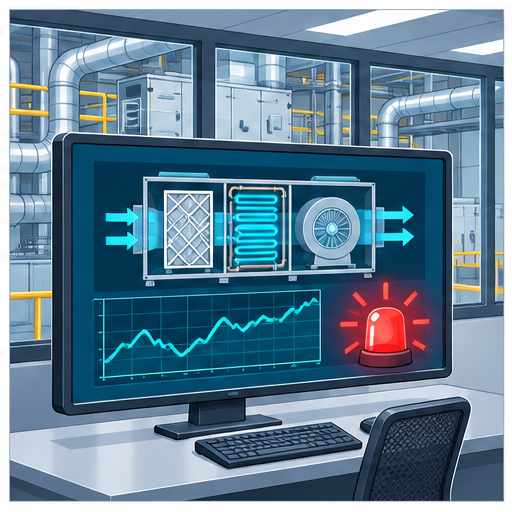

# 第 9 週｜冷卻水、電力、空調監控畫面

基礎 / foundation

## 學習目標
- 能用自己的話說明「第 9 週｜冷卻水、電力、空調監控畫面」的主要角色或資料關係。
- 能辨認本課常見誤解，並說明應查驗的資料或證據。

## 前置能力
先理解 FMCS 的資料流與監控分工。

## 原教材重點
- 依三種廠務情境設計設備關係、量測值、單位、運轉回饋、模式、警報及品質狀態。
- 完成三張監控草圖：冷卻水的溫度／壓力／流量與幫浦；電力的電壓／電流／kW／kWh；空調的溫濕度／風機／設備狀態。
- 既有水箱是操作示例，三類監控畫面是課外設計練習；設計時需將即時數值、失聯狀態與設備故障分開。
- 冷卻水：溫度、壓力、流量與幫浦回饋；電力：V、A、kW、kWh；空調：溫濕度與風機狀態。
- 每張畫面標示最後更新時間、資料品質、模式及異常；不要將控制命令當作運轉回饋。

## 圖文對照

觀察設備、數值與狀態如何安排。圖為畫面概念示意，並非本課已部署的成果。

## 常見問題
### 這一課應先掌握什麼？
依三種廠務情境設計設備關係、量測值、單位、運轉回饋、模式、警報及品質狀態。

### WindowMaker 與 WindowViewer 的分工為何？
前者編輯畫面，後者執行畫面。開發與執行環境不同，排錯需先確認正在使用哪個應用。

### Industrial Graphic 最主要的維護價值為何？
重用外觀與綁定規格。圖形可以重用，但設備參照與狀態意義仍需逐一確認。

## 記憶卡
- 問：數值綁定完成後，最可靠的核對方式為何？
  答：比對來源、Object Viewer 與執行畫面。跨層比對可揭露誤綁設備、單位或縮放問題。
- 問：運轉燈與資料品質為何要分開呈現？
  答：設備狀態與資料可信度是不同訊息。停止但資料有效，與失聯而狀態未知，應有不同呈現。
- 問：受管理與獨立式 InTouch 的設定可否直接混用？
  答：應先確認應用類型與資料參照路線。受管理應用與獨立標籤路線的維護入口及參照方式可能不同。

## 實作與學習紀錄
以本課原教材的案例，記錄一項正常情境與一項異常情境，分別寫下預期結果、實際證據及待確認事項。

- 我的說明：
- 預期與實際結果：
- 待確認問題：

## 課後五題測驗

1. 下列哪項符合本課的教材重點？
   A. 依三種廠務情境設計設備關係、量測值、單位、運轉回饋、模式、警報及品質狀態。
   B. 兩者都是歷史資料庫
   C. 前者保存 PLC 程式，後者備份 SQL

2. 複習本課的操作與判讀原則，哪一項正確？
   A. 完成三張監控草圖：冷卻水的溫度／壓力／流量與幫浦；電力的電壓／電流／kW／kWh；空調的溫濕度／風機／設備狀態。
   B. 不需再核對設備來源
   C. 自動取代所有 PLC 控制

3. 運轉燈與資料品質為何要分開呈現？
   A. 只顯示燈號可省去所有驗證
   B. 綠色永遠表示全部正常
   C. 設備狀態與資料可信度是不同訊息

4. Industrial Graphic 最主要的維護價值為何？
   A. 不需再核對設備來源
   B. 自動取代所有 PLC 控制
   C. 重用外觀與綁定規格

5. 數值綁定完成後，最可靠的核對方式為何？
   A. 只看畫面已有一個數字
   B. 比對來源、Object Viewer 與執行畫面
   C. 只檢查圖形是否居中

## 答案與解析
1. A：本課原教材重點：依三種廠務情境設計設備關係、量測值、單位、運轉回饋、模式、警報及品質狀態。
2. A：本課原教材重點：完成三張監控草圖：冷卻水的溫度／壓力／流量與幫浦；電力的電壓／電流／kW／kWh；空調的溫濕度／風機／設備狀態。
3. C：停止但資料有效，與失聯而狀態未知，應有不同呈現。
4. C：圖形可以重用，但設備參照與狀態意義仍需逐一確認。
5. B：跨層比對可揭露誤綁設備、單位或縮放問題。

## 原教材
https://chermanyen.github.io/fmcs-academy/academy.html#week-9
概念與練習沿用本站原教材；版本、來源圖及限制仍以原教材標示為準。
