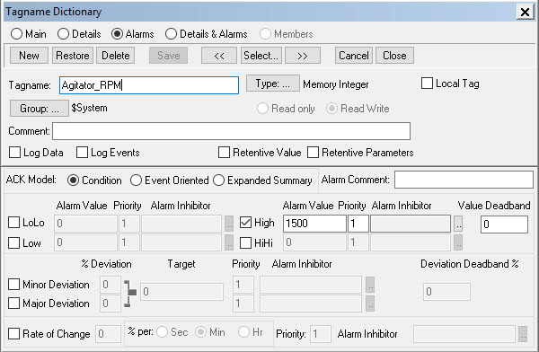

# 加入警報與歷史趨勢的閱讀入口

基礎 / intouch

## 學習目標
- 能用自己的話說明「加入警報與歷史趨勢的閱讀入口」的主要角色或資料關係。
- 能辨認本課常見誤解，並說明應查驗的資料或證據。

## 前置能力
先理解 FMCS 的資料流與監控分工。

## 原教材重點
- 先在設備 Attribute 與相關服務確認測試警報條件、優先度及歷史收集規劃。
- 在圖控加入警報與趨勢的顯示入口，選取正確設備範圍、點位與查詢時段。
- 測試警報觸發、恢復與確認；再用不同時間範圍檢查歷史趨勢與缺值。
- 警報點位與時間正確，恢復和確認可區分；歷史查詢讀到已收集的資料。
- 只放一個趨勢元件不會自動建立 Historian 收集；畫面正常也不代表歷史入庫正常。

## 圖文對照

AVEVA InTouch HMI Getting Started，PDF p.27，本機 Tag 警報參考。點圖放大；圖中的物件名稱須替換成你的測試設備。

## 常見問題
### 這一課應先掌握什麼？
先在設備 Attribute 與相關服務確認測試警報條件、優先度及歷史收集規劃。

### 即時值與歷史資料的主要差別為何？
即時值描述當下，歷史資料保存時間變化。追查事件需要保存過去樣本及其時間與品質。

### 放入趨勢元件，就代表資料已被收集嗎？
仍需確認收集設定、服務及查詢結果。畫面元件與後端收集是不同環節，必須分別驗證。

## 記憶卡
- 問：查詢某次事件的歷史資料時，應先確認什麼？
  答：點位、時間區間、時區及品質。資料選取範圍與時間基準會直接影響判讀。
- 問：歷史曲線出現缺值，適合怎麼處理？
  答：保留缺值意義並追查通訊或收集狀態。缺值可能是重要證據，補值或重取樣需有明確規則。
- 問：Historian 與 Galaxy Repository 的責任為何？
  答：前者處理設備歷史，後者保存工程組態。組態、時間序列與自建業務資料庫應分別管理。

## 實作與學習紀錄
以本課原教材的案例，記錄一項正常情境與一項異常情境，分別寫下預期結果、實際證據及待確認事項。

- 我的說明：
- 預期與實際結果：
- 待確認問題：

## 課後五題測驗

1. 下列哪項符合本課的教材重點？
   A. 先在設備 Attribute 與相關服務確認測試警報條件、優先度及歷史收集規劃。
   B. 即時值可自動還原所有過去
   C. 歷史資料就是現在畫面截圖

2. 複習本課的操作與判讀原則，哪一項正確？
   A. 只要圖上有坐標軸即可
   B. 有元件就一定有全部歷史
   C. 在圖控加入警報與趨勢的顯示入口，選取正確設備範圍、點位與查詢時段。

3. 放入趨勢元件，就代表資料已被收集嗎？
   A. 仍需確認收集設定、服務及查詢結果
   B. 只要圖上有坐標軸即可
   C. 有元件就一定有全部歷史

4. 歷史曲線出現缺值，適合怎麼處理？
   A. 保留缺值意義並追查通訊或收集狀態
   B. 任意補成正常值而不標示
   C. 刪除整段事件紀錄

5. 即時值與歷史資料的主要差別為何？
   A. 即時值可自動還原所有過去
   B. 即時值描述當下，歷史資料保存時間變化
   C. 歷史資料就是現在畫面截圖

## 答案與解析
1. A：本課原教材重點：先在設備 Attribute 與相關服務確認測試警報條件、優先度及歷史收集規劃。
2. C：本課原教材重點：在圖控加入警報與趨勢的顯示入口，選取正確設備範圍、點位與查詢時段。
3. A：畫面元件與後端收集是不同環節，必須分別驗證。
4. A：缺值可能是重要證據，補值或重取樣需有明確規則。
5. B：追查事件需要保存過去樣本及其時間與品質。

## 原教材
https://chermanyen.github.io/fmcs-academy/courses/intouch/index.html#alarms
概念與練習沿用本站原教材；版本、來源圖及限制仍以原教材標示為準。
