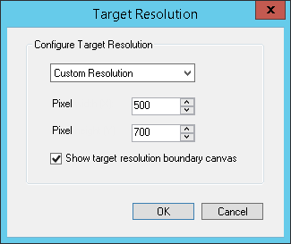

# 建立受管理的 InTouch 應用

基礎 / intouch

## 學習目標
- 能用自己的話說明「建立受管理的 InTouch 應用」的主要角色或資料關係。
- 能辨認本課常見誤解，並說明應查驗的資料或證據。

## 前置能力
先理解 FMCS 的資料流與監控分工。

## 原教材重點
- 本路線以 System Platform 的受管理 InTouch 應用為主。先確認測試 Galaxy、ViewEngine 與授權。
- 在 IDE 找到 InTouchViewApp 範本與測試實例，使用精靈建立應用並選擇目標解析度。
- 若選 InTouchView Application，外部資料來源使用 Application Server 參照；不要混用獨立式專案設定。
- 能從 IDE 開啟對應應用的 WindowMaker，應用名稱與部署位置符合測試規劃。
- 截圖包含舊版介面與範例名稱；請以安裝版本的精靈和 Help 為準。

## 圖文對照

AVEVA InTouch Application Management，2020，PDF p.56，解析度設定。點圖放大；圖中的物件名稱須替換成你的測試設備。

## 常見問題
### 這一課應先掌握什麼？
本路線以 System Platform 的受管理 InTouch 應用為主。先確認測試 Galaxy、ViewEngine 與授權。

### WindowMaker 與 WindowViewer 的分工為何？
前者編輯畫面，後者執行畫面。開發與執行環境不同，排錯需先確認正在使用哪個應用。

### Industrial Graphic 最主要的維護價值為何？
重用外觀與綁定規格。圖形可以重用，但設備參照與狀態意義仍需逐一確認。

## 記憶卡
- 問：數值綁定完成後，最可靠的核對方式為何？
  答：比對來源、Object Viewer 與執行畫面。跨層比對可揭露誤綁設備、單位或縮放問題。
- 問：運轉燈與資料品質為何要分開呈現？
  答：設備狀態與資料可信度是不同訊息。停止但資料有效，與失聯而狀態未知，應有不同呈現。
- 問：受管理與獨立式 InTouch 的設定可否直接混用？
  答：應先確認應用類型與資料參照路線。受管理應用與獨立標籤路線的維護入口及參照方式可能不同。

## 實作與學習紀錄
以本課原教材的案例，記錄一項正常情境與一項異常情境，分別寫下預期結果、實際證據及待確認事項。

- 我的說明：
- 預期與實際結果：
- 待確認問題：

## 課後五題測驗

1. 下列哪項符合本課的教材重點？
   A. 兩者都是歷史資料庫
   B. 本路線以 System Platform 的受管理 InTouch 應用為主。先確認測試 Galaxy、ViewEngine 與授權。
   C. 前者保存 PLC 程式，後者備份 SQL

2. 複習本課的操作與判讀原則，哪一項正確？
   A. 不需再核對設備來源
   B. 自動取代所有 PLC 控制
   C. 在 IDE 找到 InTouchViewApp 範本與測試實例，使用精靈建立應用並選擇目標解析度。

3. 數值綁定完成後，最可靠的核對方式為何？
   A. 只檢查圖形是否居中
   B. 只看畫面已有一個數字
   C. 比對來源、Object Viewer 與執行畫面

4. WindowMaker 與 WindowViewer 的分工為何？
   A. 兩者都是歷史資料庫
   B. 前者編輯畫面，後者執行畫面
   C. 前者保存 PLC 程式，後者備份 SQL

5. 受管理與獨立式 InTouch 的設定可否直接混用？
   A. 只要檔名相同就能互換
   B. 應先確認應用類型與資料參照路線
   C. 兩者所有設定完全相同

## 答案與解析
1. B：本課原教材重點：本路線以 System Platform 的受管理 InTouch 應用為主。先確認測試 Galaxy、ViewEngine 與授權。
2. C：本課原教材重點：在 IDE 找到 InTouchViewApp 範本與測試實例，使用精靈建立應用並選擇目標解析度。
3. C：跨層比對可揭露誤綁設備、單位或縮放問題。
4. B：開發與執行環境不同，排錯需先確認正在使用哪個應用。
5. B：受管理應用與獨立標籤路線的維護入口及參照方式可能不同。

## 原教材
https://chermanyen.github.io/fmcs-academy/courses/intouch/index.html#application
概念與練習沿用本站原教材；版本、來源圖及限制仍以原教材標示為準。
