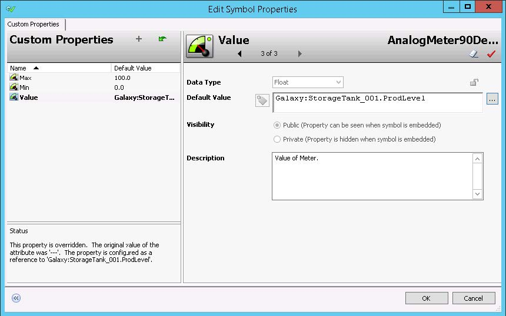

# 把溫度數值綁到正確 Attribute

基礎 / intouch

## 學習目標
- 能用自己的話說明「把溫度數值綁到正確 Attribute」的主要角色或資料關係。
- 能辨認本課常見誤解，並說明應查驗的資料或證據。

## 前置能力
先理解 FMCS 的資料流與監控分工。

## 原教材重點
- 選取要顯示數值的圖形或文字，開啟相應的顯示動畫設定。
- 透過 Galaxy Browser 選取第 1 步驗證過的實際 Attribute 完整參照，避免只憑名稱手打。
- 設定小數位及單位。回到測試來源改變數值，逐一比對來源、Object Viewer 與畫面。
- 三處數值一致，縮放與單位正確，沒有誤綁到另一台設備。
- 單位字樣不會自動替你做工程值換算；縮放位置必須與點位表一致。

## 圖文對照

AVEVA InTouch HMI Getting Started，PDF p.47，Galaxy 參照範例。點圖放大；圖中的物件名稱須替換成你的測試設備。

## 常見問題
### 這一課應先掌握什麼？
選取要顯示數值的圖形或文字，開啟相應的顯示動畫設定。

### 設計溫度 Attribute 時，除了名稱還要定義什麼？
型別、單位、來源、範圍與讀寫方向。屬性定義需足以支援採集、畫面、警報及驗收。

### 外部輸入與衍生計算值應如何區分？
記錄各自來源及計算規則。區分原始輸入與衍生值，才能追查縮放或計算問題。

## 記憶卡
- 問：點位命名應優先滿足哪項需求？
  答：能辨認設備、用途並符合專案規範。命名需支援定位及維護，還要搭配完整點位規格。
- 問：只改屬性名稱，畫面資料綁定會一定正確嗎？
  答：還需檢查引用及部署影響。依名稱建立的引用可能受變更影響，應列入回歸驗收。
- 問：狀態值與控制命令為何要分開建欄位？
  答：命令是要求，狀態是實際回授。責任分清可避免操作人員把發令成功誤判成設備已動作。

## 實作與學習紀錄
以本課原教材的案例，記錄一項正常情境與一項異常情境，分別寫下預期結果、實際證據及待確認事項。

- 我的說明：
- 預期與實際結果：
- 待確認問題：

## 課後五題測驗

1. 下列哪項符合本課的教材重點？
   A. 只填維護人姓名
   B. 只定義文字顏色
   C. 選取要顯示數值的圖形或文字，開啟相應的顯示動畫設定。

2. 複習本課的操作與判讀原則，哪一項正確？
   A. 全部用同一名稱覆蓋
   B. 透過 Galaxy Browser 選取第 1 步驗證過的實際 Attribute 完整參照，避免只憑名稱手打。
   C. 一律不保留來源

3. 只改屬性名稱，畫面資料綁定會一定正確嗎？
   A. 名稱相似就會自動正確
   B. 畫面標題會自動代替參照
   C. 還需檢查引用及部署影響

4. 設計溫度 Attribute 時，除了名稱還要定義什麼？
   A. 型別、單位、來源、範圍與讀寫方向
   B. 只定義文字顏色
   C. 只填維護人姓名

5. 點位命名應優先滿足哪項需求？
   A. 能辨認設備、用途並符合專案規範
   B. 名稱越長越好
   C. 與其他設備完全重複

## 答案與解析
1. C：本課原教材重點：選取要顯示數值的圖形或文字，開啟相應的顯示動畫設定。
2. B：本課原教材重點：透過 Galaxy Browser 選取第 1 步驗證過的實際 Attribute 完整參照，避免只憑名稱手打。
3. C：依名稱建立的引用可能受變更影響，應列入回歸驗收。
4. A：屬性定義需足以支援採集、畫面、警報及驗收。
5. A：命名需支援定位及維護，還要搭配完整點位規格。

## 原教材
https://chermanyen.github.io/fmcs-academy/courses/intouch/index.html#binding
概念與練習沿用本站原教材；版本、來源圖及限制仍以原教材標示為準。
