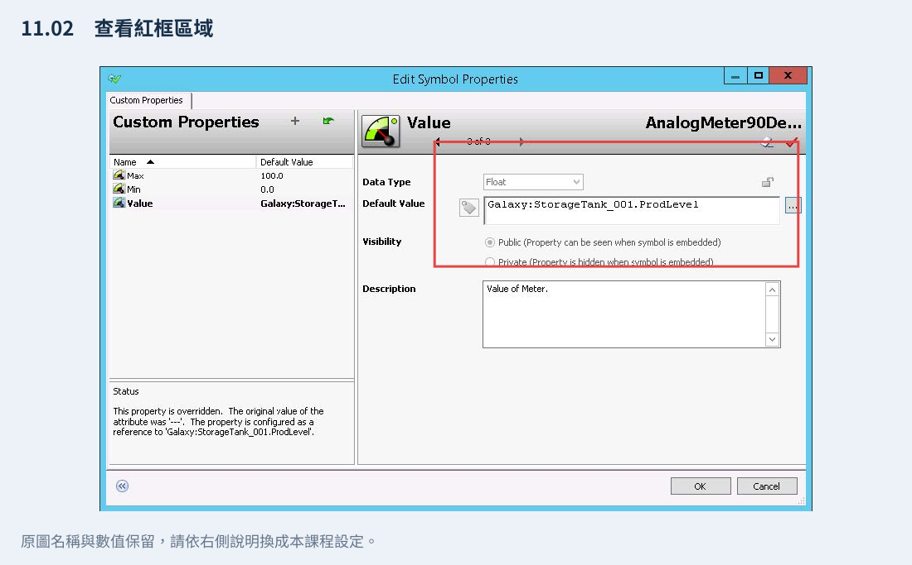

# 建立可重用 Industrial Graphic

基礎 / intouch

## 學習目標
- 能用自己的話說明「建立可重用 Industrial Graphic」的主要角色或資料關係。
- 能辨認本課常見誤解，並說明應查驗的資料或證據。

## 前置能力
先理解 FMCS 的資料流與監控分工。

## 原教材重點
- 在 IDE 的圖形工作區建立測試用 Industrial Graphic；以風機、管路、溫度與狀態文字組成 AHU 面板。
- 先使用固定文字與簡單形狀確認版面，再逐一加入資料動畫。
- 將圖形放入測試 InTouch 視窗；共用外觀應沿用現有範本，設備參照依各實例設定。
- 同一圖形可依設備參照重用，不需要複製整套畫面再逐一改文字。
- 編輯圖形與執行畫面是不同階段；尚未綁定的符號只是靜態圖。

## 圖文對照

相關 AVEVA 軟體畫面，沿用 Modbus 與備援圖文教材；介面依版本不同。。點圖放大；圖中的物件名稱須替換成你的測試設備。

## 常見問題
### 這一課應先掌握什麼？
在 IDE 的圖形工作區建立測試用 Industrial Graphic；以風機、管路、溫度與狀態文字組成 AHU 面板。

### WindowMaker 與 WindowViewer 的分工為何？
前者編輯畫面，後者執行畫面。開發與執行環境不同，排錯需先確認正在使用哪個應用。

### Industrial Graphic 最主要的維護價值為何？
重用外觀與綁定規格。圖形可以重用，但設備參照與狀態意義仍需逐一確認。

## 記憶卡
- 問：數值綁定完成後，最可靠的核對方式為何？
  答：比對來源、Object Viewer 與執行畫面。跨層比對可揭露誤綁設備、單位或縮放問題。
- 問：運轉燈與資料品質為何要分開呈現？
  答：設備狀態與資料可信度是不同訊息。停止但資料有效，與失聯而狀態未知，應有不同呈現。
- 問：受管理與獨立式 InTouch 的設定可否直接混用？
  答：應先確認應用類型與資料參照路線。受管理應用與獨立標籤路線的維護入口及參照方式可能不同。

## 實作與學習紀錄
以本課原教材的案例，記錄一項正常情境與一項異常情境，分別寫下預期結果、實際證據及待確認事項。

- 我的說明：
- 預期與實際結果：
- 待確認問題：

## 課後五題測驗

1. 下列哪項符合本課的教材重點？
   A. 前者保存 PLC 程式，後者備份 SQL
   B. 兩者都是歷史資料庫
   C. 在 IDE 的圖形工作區建立測試用 Industrial Graphic；以風機、管路、溫度與狀態文字組成 AHU 面板。

2. 複習本課的操作與判讀原則，哪一項正確？
   A. 自動取代所有 PLC 控制
   B. 不需再核對設備來源
   C. 先使用固定文字與簡單形狀確認版面，再逐一加入資料動畫。

3. 受管理與獨立式 InTouch 的設定可否直接混用？
   A. 只要檔名相同就能互換
   B. 應先確認應用類型與資料參照路線
   C. 兩者所有設定完全相同

4. 運轉燈與資料品質為何要分開呈現？
   A. 綠色永遠表示全部正常
   B. 只顯示燈號可省去所有驗證
   C. 設備狀態與資料可信度是不同訊息

5. WindowMaker 與 WindowViewer 的分工為何？
   A. 前者編輯畫面，後者執行畫面
   B. 前者保存 PLC 程式，後者備份 SQL
   C. 兩者都是歷史資料庫

## 答案與解析
1. C：本課原教材重點：在 IDE 的圖形工作區建立測試用 Industrial Graphic；以風機、管路、溫度與狀態文字組成 AHU 面板。
2. C：本課原教材重點：先使用固定文字與簡單形狀確認版面，再逐一加入資料動畫。
3. B：受管理應用與獨立標籤路線的維護入口及參照方式可能不同。
4. C：停止但資料有效，與失聯而狀態未知，應有不同呈現。
5. A：開發與執行環境不同，排錯需先確認正在使用哪個應用。

## 原教材
https://chermanyen.github.io/fmcs-academy/courses/intouch/index.html#graphic
概念與練習沿用本站原教材；版本、來源圖及限制仍以原教材標示為準。
