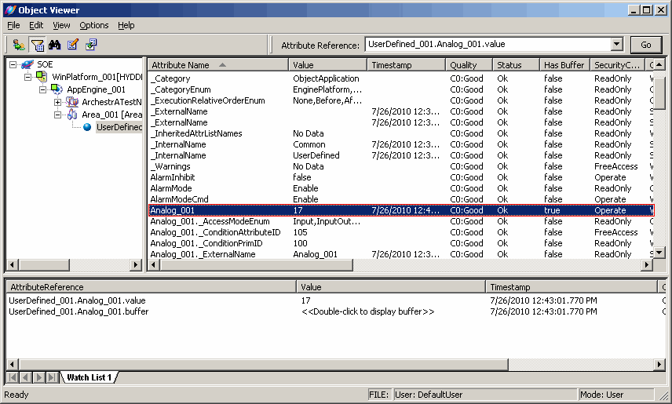

# 先在 Object Viewer 確認資料

基礎 / intouch

## 學習目標
- 能用自己的話說明「先在 Object Viewer 確認資料」的主要角色或資料關係。
- 能辨認本課常見誤解，並說明應查驗的資料或證據。

## 前置能力
先理解 FMCS 的資料流與監控分工。

## 原教材重點
- 準備一台測試 AHU，列出送風溫度、風機運轉、故障、來源狀態與品質。
- 在 IDE 的 Object Viewer 觀察測試物件，記錄每個 Attribute 的完整參照。
- 改變模擬來源，確認數值、品質與更新時間同步變化。
- Object Viewer 與來源數值一致，且能分辨無效或停止更新的資料。
- 畫面有數字不代表通訊正常；先把資料路徑驗證成功，再做圖控。

## 圖文對照

AVEVA Object Viewer 手冊，2020，PDF p.10，舊版介面。點圖放大；圖中的物件名稱須替換成你的測試設備。

## 常見問題
### 這一課應先掌握什麼？
準備一台測試 AHU，列出送風溫度、風機運轉、故障、來源狀態與品質。

### 資料品質不良但畫面還有上一筆數值，應怎麼顯示？
保留脈絡並清楚標示無效或過期。最後值可以協助追查，但須避免讓使用者誤以為仍是有效即時值。

### 判讀一筆量測資料至少應核對什麼？
值、品質及更新時間。這些資訊共同反映量測內容、可信狀態與新鮮度。

## 記憶卡
- 問：零值與未收到資料有什麼差別？
  答：零可能是有效量測，未收到資料則缺乏有效來源。需用品質及來源狀態區分，避免把缺值誤當成設備狀態。
- 問：資料時間長期不變，較好的下一步是什麼？
  答：比對來源更新、採集時間與系統時鐘。時間可揭露來源凍結或採集問題，需追查整個更新路徑。
- 問：有效來源切換後，應如何判定成功？
  答：同時核對來源、值、品質與時間。來源指示是線索，資料本身是否有效仍需驗證。

## 實作與學習紀錄
以本課原教材的案例，記錄一項正常情境與一項異常情境，分別寫下預期結果、實際證據及待確認事項。

- 我的說明：
- 預期與實際結果：
- 待確認問題：

## 課後五題測驗

1. 下列哪項符合本課的教材重點？
   A. 繼續當作正常即時值
   B. 直接改成零但不說明
   C. 準備一台測試 AHU，列出送風溫度、風機運轉、故障、來源狀態與品質。

2. 複習本課的操作與判讀原則，哪一項正確？
   A. 在 IDE 的 Object Viewer 觀察測試物件，記錄每個 Attribute 的完整參照。
   B. 只看小數位數
   C. 只看設備名稱

3. 有效來源切換後，應如何判定成功？
   A. 只看主機仍可登入
   B. 同時核對來源、值、品質與時間
   C. 只看備用燈變綠

4. 零值與未收到資料有什麼差別？
   A. 未收到值一定表示設備已停止
   B. 零可能是有效量測，未收到資料則缺乏有效來源
   C. 兩者永遠相同

5. 判讀一筆量測資料至少應核對什麼？
   A. 值、品質及更新時間
   B. 只看小數位數
   C. 只看設備名稱

## 答案與解析
1. C：本課原教材重點：準備一台測試 AHU，列出送風溫度、風機運轉、故障、來源狀態與品質。
2. A：本課原教材重點：在 IDE 的 Object Viewer 觀察測試物件，記錄每個 Attribute 的完整參照。
3. B：來源指示是線索，資料本身是否有效仍需驗證。
4. B：需用品質及來源狀態區分，避免把缺值誤當成設備狀態。
5. A：這些資訊共同反映量測內容、可信狀態與新鮮度。

## 原教材
https://chermanyen.github.io/fmcs-academy/courses/intouch/index.html#prepare
概念與練習沿用本站原教材；版本、來源圖及限制仍以原教材標示為準。
