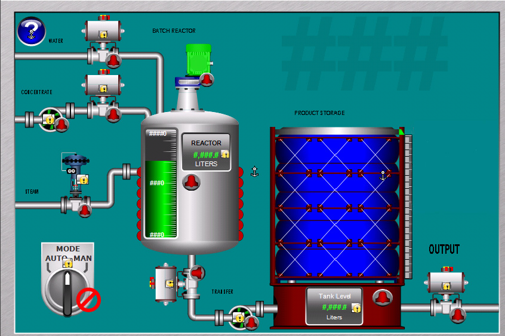

# 讓風機燈號與資料品質分開呈現

基礎 / intouch

## 學習目標
- 能用自己的話說明「讓風機燈號與資料品質分開呈現」的主要角色或資料關係。
- 能辨認本課常見誤解，並說明應查驗的資料或證據。

## 前置能力
先理解 FMCS 的資料流與監控分工。

## 原教材重點
- 將風機的運轉 Boolean 綁定到對應的填色或狀態動畫；使用文字同時標示運轉、停止或故障。
- 另設資料品質與來源狀態區。主／備用來源是否 Active，與 PLC 是否可達，是不同訊息。
- 只在隔離的測試來源模擬運轉、故障與斷線，逐一記錄畫面反應。
- 畫面能分辨「停止但資料正常」與「失聯、狀態未知」，不只依靠紅綠色判斷。
- 舊值仍存在時，不應持續呈現成有效即時值；品質判斷依實際屬性與版本設定。

## 圖文對照

AVEVA InTouch HMI Getting Started，PDF p.43，Reactor 範例非 AHU。點圖放大；圖中的物件名稱須替換成你的測試設備。

## 常見問題
### 這一課應先掌握什麼？
將風機的運轉 Boolean 綁定到對應的填色或狀態動畫；使用文字同時標示運轉、停止或故障。

### 資料品質不良但畫面還有上一筆數值，應怎麼顯示？
保留脈絡並清楚標示無效或過期。最後值可以協助追查，但須避免讓使用者誤以為仍是有效即時值。

### 判讀一筆量測資料至少應核對什麼？
值、品質及更新時間。這些資訊共同反映量測內容、可信狀態與新鮮度。

## 記憶卡
- 問：零值與未收到資料有什麼差別？
  答：零可能是有效量測，未收到資料則缺乏有效來源。需用品質及來源狀態區分，避免把缺值誤當成設備狀態。
- 問：資料時間長期不變，較好的下一步是什麼？
  答：比對來源更新、採集時間與系統時鐘。時間可揭露來源凍結或採集問題，需追查整個更新路徑。
- 問：有效來源切換後，應如何判定成功？
  答：同時核對來源、值、品質與時間。來源指示是線索，資料本身是否有效仍需驗證。

## 實作與學習紀錄
以本課原教材的案例，記錄一項正常情境與一項異常情境，分別寫下預期結果、實際證據及待確認事項。

- 我的說明：
- 預期與實際結果：
- 待確認問題：

## 課後五題測驗

1. 下列哪項符合本課的教材重點？
   A. 將風機的運轉 Boolean 綁定到對應的填色或狀態動畫；使用文字同時標示運轉、停止或故障。
   B. 繼續當作正常即時值
   C. 直接改成零但不說明

2. 複習本課的操作與判讀原則，哪一項正確？
   A. 另設資料品質與來源狀態區。主／備用來源是否 Active，與 PLC 是否可達，是不同訊息。
   B. 只看小數位數
   C. 只看設備名稱

3. 判讀一筆量測資料至少應核對什麼？
   A. 值、品質及更新時間
   B. 只看設備名稱
   C. 只看小數位數

4. 有效來源切換後，應如何判定成功？
   A. 同時核對來源、值、品質與時間
   B. 只看備用燈變綠
   C. 只看主機仍可登入

5. 零值與未收到資料有什麼差別？
   A. 兩者永遠相同
   B. 未收到值一定表示設備已停止
   C. 零可能是有效量測，未收到資料則缺乏有效來源

## 答案與解析
1. A：本課原教材重點：將風機的運轉 Boolean 綁定到對應的填色或狀態動畫；使用文字同時標示運轉、停止或故障。
2. A：本課原教材重點：另設資料品質與來源狀態區。主／備用來源是否 Active，與 PLC 是否可達，是不同訊息。
3. A：這些資訊共同反映量測內容、可信狀態與新鮮度。
4. A：來源指示是線索，資料本身是否有效仍需驗證。
5. C：需用品質及來源狀態區分，避免把缺值誤當成設備狀態。

## 原教材
https://chermanyen.github.io/fmcs-academy/courses/intouch/index.html#status
概念與練習沿用本站原教材；版本、來源圖及限制仍以原教材標示為準。
