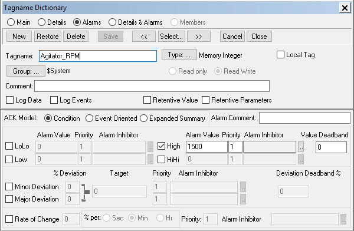

# 告警出現時，按順序確認

入門 / intro

## 學習目標
- 能用自己的話說明「告警出現時，按順序確認」的主要角色或資料關係。
- 能辨認本課常見誤解，並說明應查驗的資料或證據。

## 前置能力
不需 AVEVA 操作經驗，先辨認設備與監控的角色。

## 原教材重點
- 告警畫面提供線索，現場程序和人員判斷才是處置依據。
- 記錄點位、時間、數值、優先級和品質狀態，辨認是否為通訊中斷或測值異常。
- 檢查變化方向、持續時間，並對照相關設備與上下游監測點。
- 涉及安全或供應風險時，依現場分級通報；只由授權人員執行操作。
- 確認狀況解除、告警復歸，記錄原因、措施、時間與後續追蹤事項。

## 圖文對照

沿用相關教材畫面輔助辨認本課角色與設定位置，非本課的實測結果；介面及欄位依版本不同。

## 常見問題
### 這一課應先掌握什麼？
告警畫面提供線索，現場程序和人員判斷才是處置依據。

### 警報確認與警報恢復的差別為何？
確認表示已知悉，恢復表示條件解除。人的確認與設備條件是兩個維度，驗收應分開測試。

### 警報延遲的用途為何？
避免短暫波動立即觸發特定警報。延遲需依設備風險與規格設定，並測試持續時間的行為。

## 記憶卡
- 問：遲滯或死區可協助處理什麼問題？
  答：測值在門檻附近反覆觸發與恢復。觸發與恢復條件分開，可減少門檻附近的反覆變化。
- 問：處理警報時，較好的第一步是什麼？
  答：確認點位、時間、品質及相關趨勢。先建立上下文，再依分級與現場程序處置。
- 問：高溫警報與通訊失效應如何呈現？
  答：區分量測異常與資料無效。來源不可信時不能據此斷言設備溫度正常或異常。

## 實作與學習紀錄
以本課原教材的案例，記錄一項正常情境與一項異常情境，分別寫下預期結果、實際證據及待確認事項。

- 我的說明：
- 預期與實際結果：
- 待確認問題：

## 課後五題測驗

1. 下列哪項符合本課的教材重點？
   A. 恢復會自動證明有人知悉
   B. 告警畫面提供線索，現場程序和人員判斷才是處置依據。
   C. 確認就代表設備已修好

2. 複習本課的操作與判讀原則，哪一項正確？
   A. 保證永不發生故障
   B. 自動修復所有通訊
   C. 記錄點位、時間、數值、優先級和品質狀態，辨認是否為通訊中斷或測值異常。

3. 遲滯或死區可協助處理什麼問題？
   A. 資料庫帳號過期
   B. 測值在門檻附近反覆觸發與恢復
   C. 監控畫面字級太小

4. 警報延遲的用途為何？
   A. 自動修復所有通訊
   B. 保證永不發生故障
   C. 避免短暫波動立即觸發特定警報

5. 高溫警報與通訊失效應如何呈現？
   A. 通訊失效一律填正常溫度
   B. 都當成同一種溫度值
   C. 區分量測異常與資料無效

## 答案與解析
1. B：本課原教材重點：告警畫面提供線索，現場程序和人員判斷才是處置依據。
2. C：本課原教材重點：記錄點位、時間、數值、優先級和品質狀態，辨認是否為通訊中斷或測值異常。
3. B：觸發與恢復條件分開，可減少門檻附近的反覆變化。
4. C：延遲需依設備風險與規格設定，並測試持續時間的行為。
5. C：來源不可信時不能據此斷言設備溫度正常或異常。

## 原教材
https://chermanyen.github.io/fmcs-academy/courses/intro/index.html#topic-4
概念與練習沿用本站原教材；版本、來源圖及限制仍以原教材標示為準。
