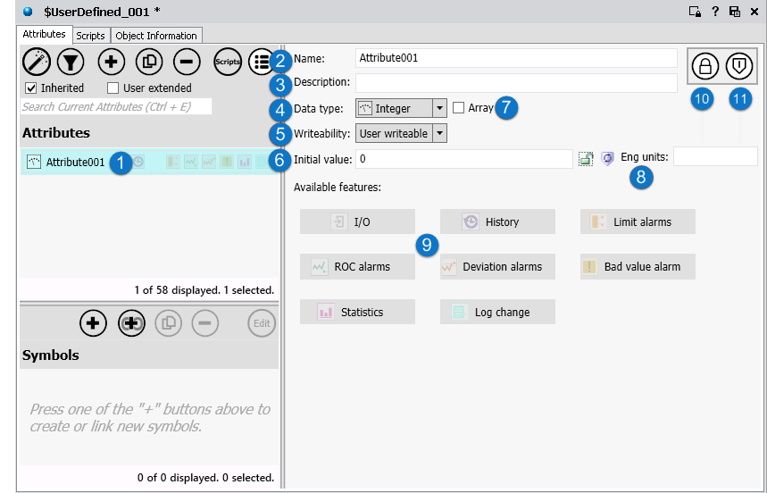

# Attribute 的設計清單

進階 / mis

## 學習目標
- 能用自己的話說明「Attribute 的設計清單」的主要角色或資料關係。
- 能辨認本課常見誤解，並說明應查驗的資料或證據。

## 前置能力
先完成平台、圖控與 AHU 基礎，或回查本課前置觀念。

## 原教材重點
- 設計項目：資料型別與單位；SupplyTemp 範例：Float，°C；檢查重點：與 PLC 工程值一致
- 設計項目：I/O 與讀寫；SupplyTemp 範例：Input／唯讀；檢查重點：來源地址及轉換位置
- 設計項目：警報條件；SupplyTemp 範例：High = 28°C（練習值）；檢查重點：延遲、死區、嚴重度
- 設計項目：歷史與安全；SupplyTemp 範例：記錄溫度／限制寫入；檢查重點：採樣、權限與資料品質
- 先做點位規格，再操作設定畫面

## 圖文對照

沿用相關教材畫面輔助辨認本課角色與設定位置，非本課的實測結果；介面及欄位依版本不同。

## 常見問題
### 這一課應先掌握什麼？
設計項目：資料型別與單位；SupplyTemp 範例：Float，°C；檢查重點：與 PLC 工程值一致

### 設計溫度 Attribute 時，除了名稱還要定義什麼？
型別、單位、來源、範圍與讀寫方向。屬性定義需足以支援採集、畫面、警報及驗收。

### 外部輸入與衍生計算值應如何區分？
記錄各自來源及計算規則。區分原始輸入與衍生值，才能追查縮放或計算問題。

## 記憶卡
- 問：點位命名應優先滿足哪項需求？
  答：能辨認設備、用途並符合專案規範。命名需支援定位及維護，還要搭配完整點位規格。
- 問：只改屬性名稱，畫面資料綁定會一定正確嗎？
  答：還需檢查引用及部署影響。依名稱建立的引用可能受變更影響，應列入回歸驗收。
- 問：狀態值與控制命令為何要分開建欄位？
  答：命令是要求，狀態是實際回授。責任分清可避免操作人員把發令成功誤判成設備已動作。

## 實作與學習紀錄
以本課原教材的案例，記錄一項正常情境與一項異常情境，分別寫下預期結果、實際證據及待確認事項。

- 我的說明：
- 預期與實際結果：
- 待確認問題：

## 課後五題測驗

1. 下列哪項符合本課的教材重點？
   A. 只填維護人姓名
   B. 只定義文字顏色
   C. 設計項目：資料型別與單位；SupplyTemp 範例：Float，°C；檢查重點：與 PLC 工程值一致

2. 複習本課的操作與判讀原則，哪一項正確？
   A. 全部用同一名稱覆蓋
   B. 設計項目：I/O 與讀寫；SupplyTemp 範例：Input／唯讀；檢查重點：來源地址及轉換位置
   C. 一律不保留來源

3. 設計溫度 Attribute 時，除了名稱還要定義什麼？
   A. 只填維護人姓名
   B. 只定義文字顏色
   C. 型別、單位、來源、範圍與讀寫方向

4. 狀態值與控制命令為何要分開建欄位？
   A. 因為所有欄位都不能讀取
   B. 命令是要求，狀態是實際回授
   C. 方便把故障藏起來

5. 點位命名應優先滿足哪項需求？
   A. 名稱越長越好
   B. 能辨認設備、用途並符合專案規範
   C. 與其他設備完全重複

## 答案與解析
1. C：本課原教材重點：設計項目：資料型別與單位；SupplyTemp 範例：Float，°C；檢查重點：與 PLC 工程值一致
2. B：本課原教材重點：設計項目：I/O 與讀寫；SupplyTemp 範例：Input／唯讀；檢查重點：來源地址及轉換位置
3. C：屬性定義需足以支援採集、畫面、警報及驗收。
4. B：責任分清可避免操作人員把發令成功誤判成設備已動作。
5. B：命名需支援定位及維護，還要搭配完整點位規格。

## 原教材
https://chermanyen.github.io/fmcs-academy/courses/mis/index.html#lesson-14
概念與練習沿用本站原教材；版本、來源圖及限制仍以原教材標示為準。
