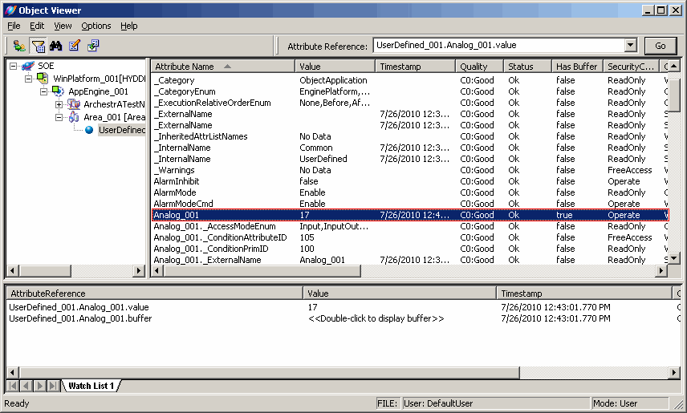

# 實作 3：部署與即時檢查

進階 / mis

## 學習目標
- 能用自己的話說明「實作 3：部署與即時檢查」的主要角色或資料關係。
- 能辨認本課常見誤解，並說明應查驗的資料或證據。

## 前置能力
先完成平台、圖控與 AHU 基礎，或回查本課前置觀念。

## 原教材重點
- Check In 全部編輯，檢查組態與語法。
- 確認 Platform、Engine、Area 的承載關係。
- 依相依順序部署，確認物件處於 OnScan。
- 用 Object Viewer 觀察與修改測試內部值。
- 1 Check In 全部編輯，檢查組態與語法。
- 2 確認 Platform、Engine、Area 的承載關係。
- 3 依相依順序部署，確認物件處於 OnScan。
- 4 用 Object Viewer 觀察與修改測試內部值。
- 驗收：SupplyTemp = 25.0，可即時觀察且品質正常

## 圖文對照

沿用相關教材畫面輔助辨認本課角色與設定位置，非本課的實測結果；介面及欄位依版本不同。

## 常見問題
### 這一課應先掌握什麼？
Check In 全部編輯，檢查組態與語法。

### 資料品質不良但畫面還有上一筆數值，應怎麼顯示？
保留脈絡並清楚標示無效或過期。最後值可以協助追查，但須避免讓使用者誤以為仍是有效即時值。

### 判讀一筆量測資料至少應核對什麼？
值、品質及更新時間。這些資訊共同反映量測內容、可信狀態與新鮮度。

## 記憶卡
- 問：零值與未收到資料有什麼差別？
  答：零可能是有效量測，未收到資料則缺乏有效來源。需用品質及來源狀態區分，避免把缺值誤當成設備狀態。
- 問：資料時間長期不變，較好的下一步是什麼？
  答：比對來源更新、採集時間與系統時鐘。時間可揭露來源凍結或採集問題，需追查整個更新路徑。
- 問：有效來源切換後，應如何判定成功？
  答：同時核對來源、值、品質與時間。來源指示是線索，資料本身是否有效仍需驗證。

## 實作與學習紀錄
以本課原教材的案例，記錄一項正常情境與一項異常情境，分別寫下預期結果、實際證據及待確認事項。

- 我的說明：
- 預期與實際結果：
- 待確認問題：

## 課後五題測驗

1. 下列哪項符合本課的教材重點？
   A. 直接改成零但不說明
   B. 繼續當作正常即時值
   C. Check In 全部編輯，檢查組態與語法。

2. 複習本課的操作與判讀原則，哪一項正確？
   A. 只看小數位數
   B. 只看設備名稱
   C. 確認 Platform、Engine、Area 的承載關係。

3. 資料品質不良但畫面還有上一筆數值，應怎麼顯示？
   A. 保留脈絡並清楚標示無效或過期
   B. 直接改成零但不說明
   C. 繼續當作正常即時值

4. 有效來源切換後，應如何判定成功？
   A. 只看備用燈變綠
   B. 只看主機仍可登入
   C. 同時核對來源、值、品質與時間

5. 判讀一筆量測資料至少應核對什麼？
   A. 只看設備名稱
   B. 只看小數位數
   C. 值、品質及更新時間

## 答案與解析
1. C：本課原教材重點：Check In 全部編輯，檢查組態與語法。
2. C：本課原教材重點：確認 Platform、Engine、Area 的承載關係。
3. A：最後值可以協助追查，但須避免讓使用者誤以為仍是有效即時值。
4. C：來源指示是線索，資料本身是否有效仍需驗證。
5. C：這些資訊共同反映量測內容、可信狀態與新鮮度。

## 原教材
https://chermanyen.github.io/fmcs-academy/courses/mis/index.html#lesson-15
概念與練習沿用本站原教材；版本、來源圖及限制仍以原教材標示為準。
