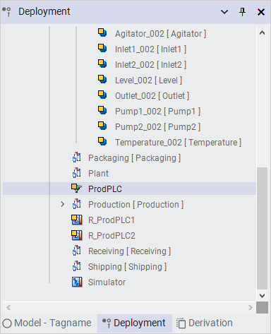

# 部署問題的快速定位

進階 / mis

## 學習目標
- 能用自己的話說明「部署問題的快速定位」的主要角色或資料關係。
- 能辨認本課常見誤解，並說明應查驗的資料或證據。

## 前置能力
先完成平台、圖控與 AHU 基礎，或回查本課前置觀念。

## 原教材重點
- 現象：無法部署；先查哪裡：Validation／部署訊息；下一個動作：修正語法與參照錯誤
- 現象：Platform 無法啟動；先查哪裡：主機名稱、服務與帳號；下一個動作：比對 Log Viewer 與事件記錄
- 現象：物件沒有變化；先查哪裡：OnScan／AppEngine 狀態；下一個動作：查引擎負載與物件排程
- 現象：改了沒有生效；先查哪裡：Check In／部署狀態；下一個動作：比對設計值與執行值
- 每次只改一項，保留錯誤時間與完整訊息

## 圖文對照

沿用相關教材畫面輔助辨認本課角色與設定位置，非本課的實測結果；介面及欄位依版本不同。

## 常見問題
### 這一課應先掌握什麼？
現象：無法部署；先查哪裡：Validation／部署訊息；下一個動作：修正語法與參照錯誤

### 完成物件編輯後，為何還要驗證與部署？
工程變更需送至正確執行環境並核對結果。設計、簽入、部署與執行驗收是不同步驟。

### 部署失敗時，先保留哪種證據？
物件、節點、時間與完整錯誤訊息。具體上下文有助於判斷權限、依賴或版本等問題。

## 記憶卡
- 問：畫面顯示舊內容時，應先核對什麼？
  答：應用版本、部署目標與執行中的實例。可能開啟了不同應用或尚未部署更新，需先確認版本與位置。
- 問：正式變更前，回復方案需要做到什麼程度？
  答：能說明回復對象、步驟及驗證方法。部署需要可操作的回復方式，且最好先在測試環境演練。
- 問：部署顯示成功後，還要做什麼？
  答：驗證讀值、品質、警報及畫面行為。部署成功是工程狀態，功能是否符合需求仍需測試。

## 實作與學習紀錄
以本課原教材的案例，記錄一項正常情境與一項異常情境，分別寫下預期結果、實際證據及待確認事項。

- 我的說明：
- 預期與實際結果：
- 待確認問題：

## 課後五題測驗

1. 下列哪項符合本課的教材重點？
   A. 儲存圖片就等於設備上線
   B. 編輯器會取代所有 Engine
   C. 現象：無法部署；先查哪裡：Validation／部署訊息；下一個動作：修正語法與參照錯誤

2. 複習本課的操作與判讀原則，哪一項正確？
   A. 只記錄心情
   B. 現象：Platform 無法啟動；先查哪裡：主機名稱、服務與帳號；下一個動作：比對 Log Viewer 與事件記錄
   C. 只截一張沒有名稱的空白圖

3. 完成物件編輯後，為何還要驗證與部署？
   A. 編輯器會取代所有 Engine
   B. 工程變更需送至正確執行環境並核對結果
   C. 儲存圖片就等於設備上線

4. 部署顯示成功後，還要做什麼？
   A. 不需再查看資料
   B. 直接刪除所有舊紀錄
   C. 驗證讀值、品質、警報及畫面行為

5. 正式變更前，回復方案需要做到什麼程度？
   A. 能說明回復對象、步驟及驗證方法
   B. 只口頭說可以重裝
   C. 等失敗後再找備份

## 答案與解析
1. C：本課原教材重點：現象：無法部署；先查哪裡：Validation／部署訊息；下一個動作：修正語法與參照錯誤
2. B：本課原教材重點：現象：Platform 無法啟動；先查哪裡：主機名稱、服務與帳號；下一個動作：比對 Log Viewer 與事件記錄
3. B：設計、簽入、部署與執行驗收是不同步驟。
4. C：部署成功是工程狀態，功能是否符合需求仍需測試。
5. A：部署需要可操作的回復方式，且最好先在測試環境演練。

## 原教材
https://chermanyen.github.io/fmcs-academy/courses/mis/index.html#lesson-16
概念與練習沿用本站原教材；版本、來源圖及限制仍以原教材標示為準。
