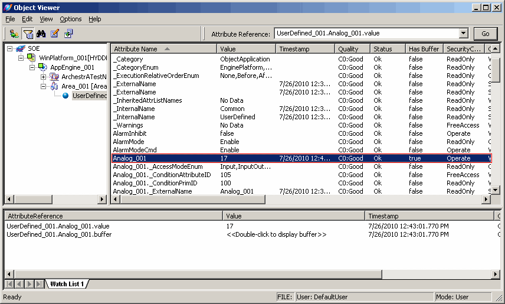

# 數值、品質與時間戳的判讀

進階 / mis

## 學習目標
- 能用自己的話說明「數值、品質與時間戳的判讀」的主要角色或資料關係。
- 能辨認本課常見誤解，並說明應查驗的資料或證據。

## 前置能力
先完成平台、圖控與 AHU 基礎，或回查本課前置觀念。

## 原教材重點
- 測試情境：正常 25°C；觀察結果：值與時間持續更新；正確處理：顯示正常讀值
- 測試情境：通訊中斷；觀察結果：品質變差或時間停滯；正確處理：顯示失聯，阻擋不當寫入
- 測試情境：值放大十倍；觀察結果：250 與 25 不一致；正確處理：查倍率與型別
- 測試情境：不同系統時間不同；觀察結果：事件先後順序矛盾；正確處理：修正時間同步與時區
- 最後一次正常值，不能單獨證明設備目前正常

## 圖文對照

沿用相關教材畫面輔助辨認本課角色與設定位置，非本課的實測結果；介面及欄位依版本不同。

## 常見問題
### 這一課應先掌握什麼？
測試情境：正常 25°C；觀察結果：值與時間持續更新；正確處理：顯示正常讀值

### 資料品質不良但畫面還有上一筆數值，應怎麼顯示？
保留脈絡並清楚標示無效或過期。最後值可以協助追查，但須避免讓使用者誤以為仍是有效即時值。

### 判讀一筆量測資料至少應核對什麼？
值、品質及更新時間。這些資訊共同反映量測內容、可信狀態與新鮮度。

## 記憶卡
- 問：零值與未收到資料有什麼差別？
  答：零可能是有效量測，未收到資料則缺乏有效來源。需用品質及來源狀態區分，避免把缺值誤當成設備狀態。
- 問：資料時間長期不變，較好的下一步是什麼？
  答：比對來源更新、採集時間與系統時鐘。時間可揭露來源凍結或採集問題，需追查整個更新路徑。
- 問：有效來源切換後，應如何判定成功？
  答：同時核對來源、值、品質與時間。來源指示是線索，資料本身是否有效仍需驗證。

## 實作與學習紀錄
以本課原教材的案例，記錄一項正常情境與一項異常情境，分別寫下預期結果、實際證據及待確認事項。

- 我的說明：
- 預期與實際結果：
- 待確認問題：

## 課後五題測驗

1. 下列哪項符合本課的教材重點？
   A. 直接改成零但不說明
   B. 測試情境：正常 25°C；觀察結果：值與時間持續更新；正確處理：顯示正常讀值
   C. 繼續當作正常即時值

2. 複習本課的操作與判讀原則，哪一項正確？
   A. 測試情境：通訊中斷；觀察結果：品質變差或時間停滯；正確處理：顯示失聯，阻擋不當寫入
   B. 只看小數位數
   C. 只看設備名稱

3. 判讀一筆量測資料至少應核對什麼？
   A. 只看設備名稱
   B. 值、品質及更新時間
   C. 只看小數位數

4. 資料時間長期不變，較好的下一步是什麼？
   A. 把時間欄位隱藏
   B. 比對來源更新、採集時間與系統時鐘
   C. 只重新整理網頁就結案

5. 資料品質不良但畫面還有上一筆數值，應怎麼顯示？
   A. 繼續當作正常即時值
   B. 直接改成零但不說明
   C. 保留脈絡並清楚標示無效或過期

## 答案與解析
1. B：本課原教材重點：測試情境：正常 25°C；觀察結果：值與時間持續更新；正確處理：顯示正常讀值
2. A：本課原教材重點：測試情境：通訊中斷；觀察結果：品質變差或時間停滯；正確處理：顯示失聯，阻擋不當寫入
3. B：這些資訊共同反映量測內容、可信狀態與新鮮度。
4. B：時間可揭露來源凍結或採集問題，需追查整個更新路徑。
5. C：最後值可以協助追查，但須避免讓使用者誤以為仍是有效即時值。

## 原教材
https://chermanyen.github.io/fmcs-academy/courses/mis/index.html#lesson-19
概念與練習沿用本站原教材；版本、來源圖及限制仍以原教材標示為準。
