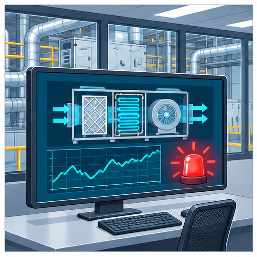

# 圖控畫面要呈現操作情境

進階 / mis

## 學習目標
- 能用自己的話說明「圖控畫面要呈現操作情境」的主要角色或資料關係。
- 能辨認本課常見誤解，並說明應查驗的資料或證據。

## 前置能力
先完成平台、圖控與 AHU 基礎，或回查本課前置觀念。

## 原教材重點
- 全廠總覽：設備是否異常、異常在哪裡。
- 設備頁：即時值、模式、回授及命令。
- 警報與趨勢：發生時間及前後變化。
- AHU 圖控、趨勢與警報（概念示意）

## 圖文對照

觀察設備、數值與狀態如何安排。圖為畫面概念示意，並非本課已部署的成果。

## 常見問題
### 這一課應先掌握什麼？
全廠總覽：設備是否異常、異常在哪裡。

### WindowMaker 與 WindowViewer 的分工為何？
前者編輯畫面，後者執行畫面。開發與執行環境不同，排錯需先確認正在使用哪個應用。

### Industrial Graphic 最主要的維護價值為何？
重用外觀與綁定規格。圖形可以重用，但設備參照與狀態意義仍需逐一確認。

## 記憶卡
- 問：數值綁定完成後，最可靠的核對方式為何？
  答：比對來源、Object Viewer 與執行畫面。跨層比對可揭露誤綁設備、單位或縮放問題。
- 問：運轉燈與資料品質為何要分開呈現？
  答：設備狀態與資料可信度是不同訊息。停止但資料有效，與失聯而狀態未知，應有不同呈現。
- 問：受管理與獨立式 InTouch 的設定可否直接混用？
  答：應先確認應用類型與資料參照路線。受管理應用與獨立標籤路線的維護入口及參照方式可能不同。

## 實作與學習紀錄
以本課原教材的案例，記錄一項正常情境與一項異常情境，分別寫下預期結果、實際證據及待確認事項。

- 我的說明：
- 預期與實際結果：
- 待確認問題：

## 課後五題測驗

1. 下列哪項符合本課的教材重點？
   A. 前者保存 PLC 程式，後者備份 SQL
   B. 全廠總覽：設備是否異常、異常在哪裡。
   C. 兩者都是歷史資料庫

2. 複習本課的操作與判讀原則，哪一項正確？
   A. 設備頁：即時值、模式、回授及命令。
   B. 自動取代所有 PLC 控制
   C. 不需再核對設備來源

3. WindowMaker 與 WindowViewer 的分工為何？
   A. 前者編輯畫面，後者執行畫面
   B. 前者保存 PLC 程式，後者備份 SQL
   C. 兩者都是歷史資料庫

4. 數值綁定完成後，最可靠的核對方式為何？
   A. 只檢查圖形是否居中
   B. 只看畫面已有一個數字
   C. 比對來源、Object Viewer 與執行畫面

5. Industrial Graphic 最主要的維護價值為何？
   A. 自動取代所有 PLC 控制
   B. 不需再核對設備來源
   C. 重用外觀與綁定規格

## 答案與解析
1. B：本課原教材重點：全廠總覽：設備是否異常、異常在哪裡。
2. A：本課原教材重點：設備頁：即時值、模式、回授及命令。
3. A：開發與執行環境不同，排錯需先確認正在使用哪個應用。
4. C：跨層比對可揭露誤綁設備、單位或縮放問題。
5. C：圖形可以重用，但設備參照與狀態意義仍需逐一確認。

## 原教材
https://chermanyen.github.io/fmcs-academy/courses/mis/index.html#lesson-20
概念與練習沿用本站原教材；版本、來源圖及限制仍以原教材標示為準。
