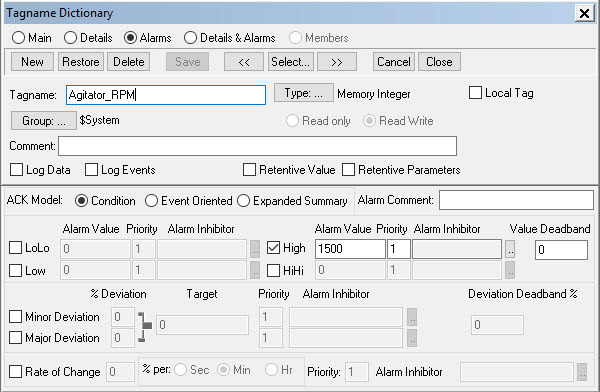

# 警報設計：讓操作員知道該做什麼

進階 / mis

## 學習目標
- 能用自己的話說明「警報設計：讓操作員知道該做什麼」的主要角色或資料關係。
- 能辨認本課常見誤解，並說明應查驗的資料或證據。

## 前置能力
先完成平台、圖控與 AHU 基礎，或回查本課前置觀念。

## 原教材重點
- 練習設定：送風溫度超過 28°C，持續 10 秒告警。
- 恢復條件：低於 27°C，避免臨界值反覆跳動。
- 訊息要包含設備、位置、原因與建議處置。
- 確認 Ack 表示已知悉，設備恢復有獨立條件。
- 28／27°C 與 10 秒都是練習值，須由製程確認

## 圖文對照

沿用相關教材畫面輔助辨認本課角色與設定位置，非本課的實測結果；介面及欄位依版本不同。

## 常見問題
### 這一課應先掌握什麼？
練習設定：送風溫度超過 28°C，持續 10 秒告警。

### 警報確認與警報恢復的差別為何？
確認表示已知悉，恢復表示條件解除。人的確認與設備條件是兩個維度，驗收應分開測試。

### 警報延遲的用途為何？
避免短暫波動立即觸發特定警報。延遲需依設備風險與規格設定，並測試持續時間的行為。

## 記憶卡
- 問：遲滯或死區可協助處理什麼問題？
  答：測值在門檻附近反覆觸發與恢復。觸發與恢復條件分開，可減少門檻附近的反覆變化。
- 問：處理警報時，較好的第一步是什麼？
  答：確認點位、時間、品質及相關趨勢。先建立上下文，再依分級與現場程序處置。
- 問：高溫警報與通訊失效應如何呈現？
  答：區分量測異常與資料無效。來源不可信時不能據此斷言設備溫度正常或異常。

## 實作與學習紀錄
以本課原教材的案例，記錄一項正常情境與一項異常情境，分別寫下預期結果、實際證據及待確認事項。

- 我的說明：
- 預期與實際結果：
- 待確認問題：

## 課後五題測驗

1. 下列哪項符合本課的教材重點？
   A. 確認就代表設備已修好
   B. 練習設定：送風溫度超過 28°C，持續 10 秒告警。
   C. 恢復會自動證明有人知悉

2. 複習本課的操作與判讀原則，哪一項正確？
   A. 自動修復所有通訊
   B. 保證永不發生故障
   C. 恢復條件：低於 27°C，避免臨界值反覆跳動。

3. 處理警報時，較好的第一步是什麼？
   A. 確認點位、時間、品質及相關趨勢
   B. 先將全部設備重啟
   C. 直接提高門檻讓它消失

4. 遲滯或死區可協助處理什麼問題？
   A. 資料庫帳號過期
   B. 測值在門檻附近反覆觸發與恢復
   C. 監控畫面字級太小

5. 警報確認與警報恢復的差別為何？
   A. 確認表示已知悉，恢復表示條件解除
   B. 恢復會自動證明有人知悉
   C. 確認就代表設備已修好

## 答案與解析
1. B：本課原教材重點：練習設定：送風溫度超過 28°C，持續 10 秒告警。
2. C：本課原教材重點：恢復條件：低於 27°C，避免臨界值反覆跳動。
3. A：先建立上下文，再依分級與現場程序處置。
4. B：觸發與恢復條件分開，可減少門檻附近的反覆變化。
5. A：人的確認與設備條件是兩個維度，驗收應分開測試。

## 原教材
https://chermanyen.github.io/fmcs-academy/courses/mis/index.html#lesson-23
概念與練習沿用本站原教材；版本、來源圖及限制仍以原教材標示為準。
