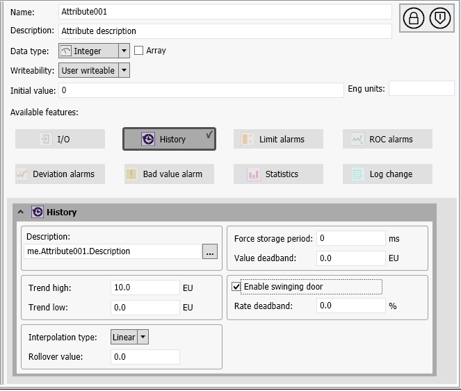

# Historian 與 SQL Server 的分工

進階 / mis

## 學習目標
- 能用自己的話說明「Historian 與 SQL Server 的分工」的主要角色或資料關係。
- 能辨認本課常見誤解，並說明應查驗的資料或證據。

## 前置能力
先完成平台、圖控與 AHU 基礎，或回查本課前置觀念。

## 原教材重點
- 項目：典型資料；Historian：設備時間序列與品質；一般 SQL 業務資料：工單、設備主檔、申請紀錄
- 項目：讀取方式；Historian：依產品支援的查詢介面；一般 SQL 業務資料：應用程式 SQL／API
- 項目：時間處理；Historian：採樣、壓縮與重取樣；一般 SQL 業務資料：依業務模型自行設計
- 項目：變更原則；Historian：使用受支援工具設定；一般 SQL 業務資料：依自有 DB 變更流程
- Galaxy Repository、Historian 與自建業務 DB 分別管理

## 圖文對照

沿用相關教材畫面輔助辨認本課角色與設定位置，非本課的實測結果；介面及欄位依版本不同。

## 常見問題
### 這一課應先掌握什麼？
項目：典型資料；Historian：設備時間序列與品質；一般 SQL 業務資料：工單、設備主檔、申請紀錄

### 即時值與歷史資料的主要差別為何？
即時值描述當下，歷史資料保存時間變化。追查事件需要保存過去樣本及其時間與品質。

### 放入趨勢元件，就代表資料已被收集嗎？
仍需確認收集設定、服務及查詢結果。畫面元件與後端收集是不同環節，必須分別驗證。

## 記憶卡
- 問：查詢某次事件的歷史資料時，應先確認什麼？
  答：點位、時間區間、時區及品質。資料選取範圍與時間基準會直接影響判讀。
- 問：歷史曲線出現缺值，適合怎麼處理？
  答：保留缺值意義並追查通訊或收集狀態。缺值可能是重要證據，補值或重取樣需有明確規則。
- 問：Historian 與 Galaxy Repository 的責任為何？
  答：前者處理設備歷史，後者保存工程組態。組態、時間序列與自建業務資料庫應分別管理。

## 實作與學習紀錄
以本課原教材的案例，記錄一項正常情境與一項異常情境，分別寫下預期結果、實際證據及待確認事項。

- 我的說明：
- 預期與實際結果：
- 待確認問題：

## 課後五題測驗

1. 下列哪項符合本課的教材重點？
   A. 即時值可自動還原所有過去
   B. 項目：典型資料；Historian：設備時間序列與品質；一般 SQL 業務資料：工單、設備主檔、申請紀錄
   C. 歷史資料就是現在畫面截圖

2. 複習本課的操作與判讀原則，哪一項正確？
   A. 有元件就一定有全部歷史
   B. 只要圖上有坐標軸即可
   C. 項目：讀取方式；Historian：依產品支援的查詢介面；一般 SQL 業務資料：應用程式 SQL／API

3. Historian 與 Galaxy Repository 的責任為何？
   A. 兩者資料可以任意互改
   B. 兩者都只是圖形編輯器
   C. 前者處理設備歷史，後者保存工程組態

4. 即時值與歷史資料的主要差別為何？
   A. 即時值可自動還原所有過去
   B. 即時值描述當下，歷史資料保存時間變化
   C. 歷史資料就是現在畫面截圖

5. 查詢某次事件的歷史資料時，應先確認什麼？
   A. 只確認線條顏色
   B. 只查現在的最後值
   C. 點位、時間區間、時區及品質

## 答案與解析
1. B：本課原教材重點：項目：典型資料；Historian：設備時間序列與品質；一般 SQL 業務資料：工單、設備主檔、申請紀錄
2. C：本課原教材重點：項目：讀取方式；Historian：依產品支援的查詢介面；一般 SQL 業務資料：應用程式 SQL／API
3. C：組態、時間序列與自建業務資料庫應分別管理。
4. B：追查事件需要保存過去樣本及其時間與品質。
5. C：資料選取範圍與時間基準會直接影響判讀。

## 原教材
https://chermanyen.github.io/fmcs-academy/courses/mis/index.html#lesson-25
概念與練習沿用本站原教材；版本、來源圖及限制仍以原教材標示為準。
