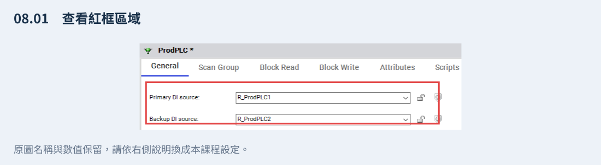

# 備援配置與 PingItem

進階 / modbus

## 學習目標
- 能用自己的話說明「備援配置與 PingItem」的主要角色或資料關係。
- 能辨認本課常見誤解，並說明應查驗的資料或證據。

## 前置能力
先完成平台、圖控與 AHU 基礎，或回查本課前置觀念。

## 原教材重點
- 對照 General、Copy Common Scan Groups 與 Scan Group，再以內建 Help 確認本版診斷屬性。
- 建立 DI_Redundant，General 指定 DI_Primary 與 DI_Backup。
- 建立共同 Scan Group，確認兩個來源都有對應群組與相同項目空間。
- 檢查群組的 PingItem 等可用診斷屬性，選取有效 PLC 項目；本圖僅顯示群組，PingItem 可能需從屬性檢視存取。
- PingItem 不是 Windows ping，也不自動證明 PLC 控制程式正在正常掃描。
- 完成 Validate、Check-in 與部署，確認來源狀態與資料品質。

## 圖文對照

公開技術教材：DI Redundancy，General 頁，非你的環境

## 常見問題
### 這一課應先掌握什麼？
對照 General、Copy Common Scan Groups 與 Scan Group，再以內建 Help 確認本版診斷屬性。

### 兩台 OI Server 共用一台 PLC，仍可能有什麼風險？
共用 PLC 或其他共同節點仍是單點。備援只能降低其涵蓋範圍的故障，不能消除所有共同依賴。

### 主要來源故障時，判定備用接手需要看什麼？
有效來源、值、品質、時間及切換耗時。資料仍可用才是切換成效的核心，需保留驗收證據。

## 記憶卡
- 問：主來源恢復後，可以預設一定自動回切嗎？
  答：需依實際設定與版本驗證。切換與回切策略不同，不能用教材模擬取代產品設定。
- 問：RedundantDIObject 的備援對象主要是什麼？
  答：Device Integration 資料來源。RDI 依配置協調來源，仍需驗證底層驅動與共同執行環境。
- 問：兩條路徑都失去同一台 PLC 時，應怎麼呈現？
  答：顯示資料無效並依程序處理。共同來源故障可能同時影響兩路，畫面須避免誤導。

## 實作與學習紀錄
以本課原教材的案例，記錄一項正常情境與一項異常情境，分別寫下預期結果、實際證據及待確認事項。

- 我的說明：
- 預期與實際結果：
- 待確認問題：

## 課後五題測驗

1. 下列哪項符合本課的教材重點？
   A. 任何故障都可自動補救
   B. 對照 General、Copy Common Scan Groups 與 Scan Group，再以內建 Help 確認本版診斷屬性。
   C. 只要有兩個圖示就沒有風險

2. 複習本課的操作與判讀原則，哪一項正確？
   A. 只看燈號改色
   B. 建立 DI_Redundant，General 指定 DI_Primary 與 DI_Backup。
   C. 只看備用電腦開著

3. 兩條路徑都失去同一台 PLC 時，應怎麼呈現？
   A. 自動宣稱備用來源健康
   B. 把最後值當正常即時值
   C. 顯示資料無效並依程序處理

4. 主來源恢復後，可以預設一定自動回切嗎？
   A. 永遠不可能回切
   B. 需依實際設定與版本驗證
   C. 所有系統一定立即回切

5. 主要來源故障時，判定備用接手需要看什麼？
   A. 只看備用電腦開著
   B. 只看燈號改色
   C. 有效來源、值、品質、時間及切換耗時

## 答案與解析
1. B：本課原教材重點：對照 General、Copy Common Scan Groups 與 Scan Group，再以內建 Help 確認本版診斷屬性。
2. B：本課原教材重點：建立 DI_Redundant，General 指定 DI_Primary 與 DI_Backup。
3. C：共同來源故障可能同時影響兩路，畫面須避免誤導。
4. B：切換與回切策略不同，不能用教材模擬取代產品設定。
5. C：資料仍可用才是切換成效的核心，需保留驗收證據。

## 原教材
https://chermanyen.github.io/fmcs-academy/courses/modbus/index.html#topic-10
概念與練習沿用本站原教材；版本、來源圖及限制仍以原教材標示為準。
