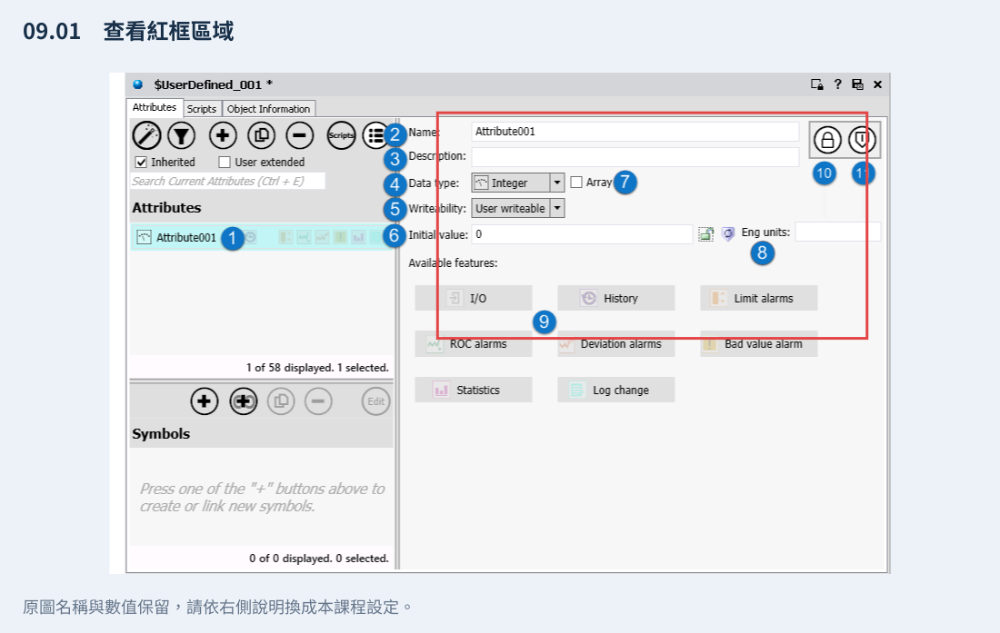

# AHU 模板與兩台實例

進階 / modbus

## 學習目標
- 能用自己的話說明「AHU 模板與兩台實例」的主要角色或資料關係。
- 能辨認本課常見誤解，並說明應查驗的資料或證據。

## 前置能力
先完成平台、圖控與 AHU 基礎，或回查本課前置觀念。

## 原教材重點
- 共用規格放模板，每台設備的來源與專屬參數放實例。
- 從 $UserDefined 衍生 $AHU_Template。
- 新增 RoomTempRaw：Integer；RoomTemp：Float；FanRunning、FanFault：Boolean。
- 將 Raw 與回授的 I/O 參照透過瀏覽器對應 DI_Redundant 的群組及項目。
- 只在一層設定縮放。若使用支援此功能的 I/O 線性縮放，原始 0–1000 對應 0–100°C；勿再重複除以 10。
- 建立 AHU_001、AHU_002，各自配置資料來源；第二台需有自己的 PLC 點位。

## 圖文對照

AVEVA Application Server 手冊，2020，PDF p.123，舊版介面

## 常見問題
### 這一課應先掌握什麼？
共用規格放模板，每台設備的來源與專屬參數放實例。

### Template 與 Instance 的關係為何？
範本定義共用規格，實例代表具體設備。共用結構可重用，具體設備仍保有自己的來源與狀態。

### 兩台設備共用範本，哪些內容通常仍須分開確認？
設備來源與專屬參數。範本重用不代表把不同設備的資料合併。

## 記憶卡
- 問：修改共用範本前，應先確認什麼？
  答：衍生實例的影響範圍與測試方式。共用規格可能影響多個實例，變更需先盤點與驗證。
- 問：Attribute 在設備物件中表示什麼？
  答：一項資料欄位或狀態屬性。Attribute 承載設備的數值、狀態或設定，其型別與來源需明確。
- 問：建立可維護的設備範本，較好的原則為何？
  答：共通規格集中，個別差異明確。共用與差異分清可減少重複維護及映射錯誤。

## 實作與學習紀錄
以本課原教材的案例，記錄一項正常情境與一項異常情境，分別寫下預期結果、實際證據及待確認事項。

- 我的說明：
- 預期與實際結果：
- 待確認問題：

## 課後五題測驗

1. 下列哪項符合本課的教材重點？
   A. 實例只能有一個固定值
   B. 共用規格放模板，每台設備的來源與專屬參數放實例。
   C. 兩者都是同一台實體 PLC

2. 複習本課的操作與判讀原則，哪一項正確？
   A. 兩台永遠共用一個來源
   B. 從 $UserDefined 衍生 $AHU_Template。
   C. 只需改中文名稱

3. Attribute 在設備物件中表示什麼？
   A. 一個完整資料中心
   B. 一張 PowerPoint 頁面
   C. 一項資料欄位或狀態屬性

4. 建立可維護的設備範本，較好的原則為何？
   A. 為每台設備複製全部程式
   B. 把所有欄位都改為文字
   C. 共通規格集中，個別差異明確

5. Template 與 Instance 的關係為何？
   A. 兩者都是同一台實體 PLC
   B. 實例只能有一個固定值
   C. 範本定義共用規格，實例代表具體設備

## 答案與解析
1. B：本課原教材重點：共用規格放模板，每台設備的來源與專屬參數放實例。
2. B：本課原教材重點：從 $UserDefined 衍生 $AHU_Template。
3. C：Attribute 承載設備的數值、狀態或設定，其型別與來源需明確。
4. C：共用與差異分清可減少重複維護及映射錯誤。
5. C：共用結構可重用，具體設備仍保有自己的來源與狀態。

## 原教材
https://chermanyen.github.io/fmcs-academy/courses/modbus/index.html#topic-11
概念與練習沿用本站原教材；版本、來源圖及限制仍以原教材標示為準。
