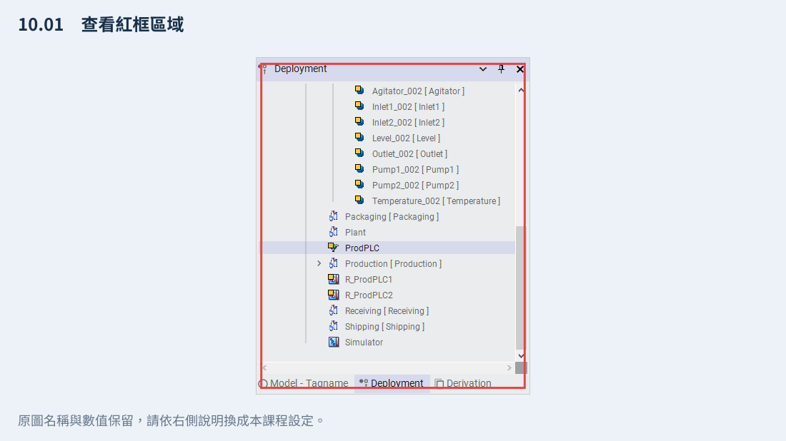

# 部署與讀值驗收

進階 / modbus

## 學習目標
- 能用自己的話說明「部署與讀值驗收」的主要角色或資料關係。
- 能辨認本課常見誤解，並說明應查驗的資料或證據。

## 前置能力
先完成平台、圖控與 AHU 基礎，或回查本課前置觀念。

## 原教材重點
- Model 看邏輯分類，Deployment 看物件實際執行的位置。
- WinPlatform 對應測試執行電腦，AppEngine 承載通訊與設備物件。
- 確認 Area、來源 DI、RDI 與 AHU 的指派及依賴。
- Validate 後 Check-in，再部署所需物件，依部署訊息排錯。
- Object Viewer：Raw 230、RoomTemp 23.0、品質正常。
- 若為 2.3 或 230，檢查是否重複縮放或未縮放。

## 圖文對照

公開技術教材：Deployment 檢視，拓樸僅供參考

## 常見問題
### 這一課應先掌握什麼？
Model 看邏輯分類，Deployment 看物件實際執行的位置。

### 完成物件編輯後，為何還要驗證與部署？
工程變更需送至正確執行環境並核對結果。設計、簽入、部署與執行驗收是不同步驟。

### 部署失敗時，先保留哪種證據？
物件、節點、時間與完整錯誤訊息。具體上下文有助於判斷權限、依賴或版本等問題。

## 記憶卡
- 問：畫面顯示舊內容時，應先核對什麼？
  答：應用版本、部署目標與執行中的實例。可能開啟了不同應用或尚未部署更新，需先確認版本與位置。
- 問：正式變更前，回復方案需要做到什麼程度？
  答：能說明回復對象、步驟及驗證方法。部署需要可操作的回復方式，且最好先在測試環境演練。
- 問：部署顯示成功後，還要做什麼？
  答：驗證讀值、品質、警報及畫面行為。部署成功是工程狀態，功能是否符合需求仍需測試。

## 實作與學習紀錄
以本課原教材的案例，記錄一項正常情境與一項異常情境，分別寫下預期結果、實際證據及待確認事項。

- 我的說明：
- 預期與實際結果：
- 待確認問題：

## 課後五題測驗

1. 下列哪項符合本課的教材重點？
   A. 編輯器會取代所有 Engine
   B. 儲存圖片就等於設備上線
   C. Model 看邏輯分類，Deployment 看物件實際執行的位置。

2. 複習本課的操作與判讀原則，哪一項正確？
   A. 只截一張沒有名稱的空白圖
   B. WinPlatform 對應測試執行電腦，AppEngine 承載通訊與設備物件。
   C. 只記錄心情

3. 部署失敗時，先保留哪種證據？
   A. 只截一張沒有名稱的空白圖
   B. 只記錄心情
   C. 物件、節點、時間與完整錯誤訊息

4. 正式變更前，回復方案需要做到什麼程度？
   A. 能說明回復對象、步驟及驗證方法
   B. 等失敗後再找備份
   C. 只口頭說可以重裝

5. 部署顯示成功後，還要做什麼？
   A. 不需再查看資料
   B. 驗證讀值、品質、警報及畫面行為
   C. 直接刪除所有舊紀錄

## 答案與解析
1. C：本課原教材重點：Model 看邏輯分類，Deployment 看物件實際執行的位置。
2. B：本課原教材重點：WinPlatform 對應測試執行電腦，AppEngine 承載通訊與設備物件。
3. C：具體上下文有助於判斷權限、依賴或版本等問題。
4. A：部署需要可操作的回復方式，且最好先在測試環境演練。
5. B：部署成功是工程狀態，功能是否符合需求仍需測試。

## 原教材
https://chermanyen.github.io/fmcs-academy/courses/modbus/index.html#topic-12
概念與練習沿用本站原教材；版本、來源圖及限制仍以原教材標示為準。
