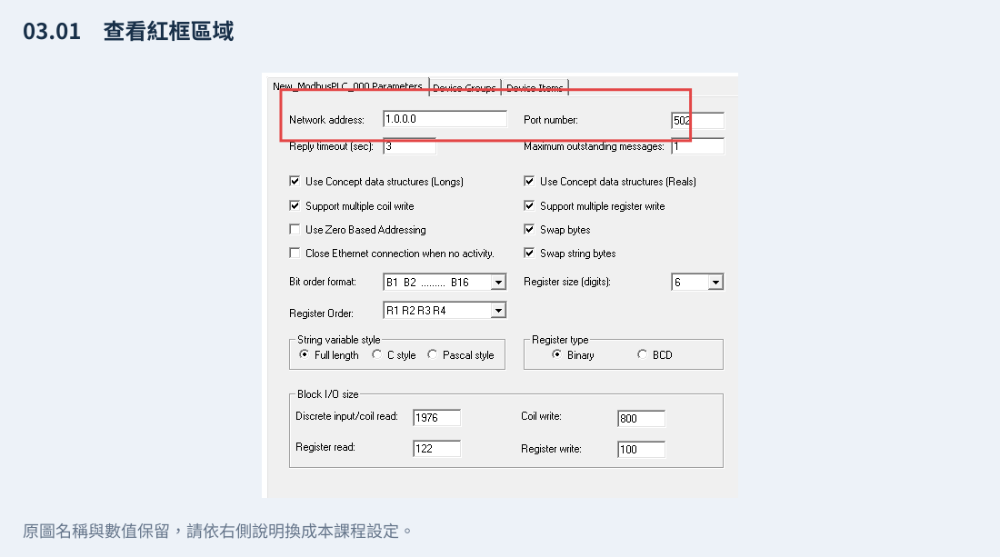

# 練習點位對照表

進階 / modbus

## 學習目標
- 能用自己的話說明「練習點位對照表」的主要角色或資料關係。
- 能辨認本課常見誤解，並說明應查驗的資料或證據。

## 前置能力
先完成平台、圖控與 AHU 基礎，或回查本課前置觀念。

## 原教材重點
- 資料類型／Offset原始值工程值
- 區域溫度Holding Register／023023.0°C
- 送風溫度Holding Register／118518.5°C
- 濾網壓差Holding Register／2150150 Pa
- 風機運轉／故障Discrete Input／0、11／0運轉／無故障
- 以上映射須在 PLC 程式中確實建立。MBTCP 預設六位數 1-based 表示法下，第一筆 Holding Register 是 400001；其他定址模式必須另查驅動說明。

## 圖文對照

點位表為課程規劃，截圖為 MBTCP 官方手冊介面。

## 常見問題
### 這一課應先掌握什麼？
資料類型／Offset原始值工程值

### 設計溫度 Attribute 時，除了名稱還要定義什麼？
型別、單位、來源、範圍與讀寫方向。屬性定義需足以支援採集、畫面、警報及驗收。

### 外部輸入與衍生計算值應如何區分？
記錄各自來源及計算規則。區分原始輸入與衍生值，才能追查縮放或計算問題。

## 記憶卡
- 問：點位命名應優先滿足哪項需求？
  答：能辨認設備、用途並符合專案規範。命名需支援定位及維護，還要搭配完整點位規格。
- 問：只改屬性名稱，畫面資料綁定會一定正確嗎？
  答：還需檢查引用及部署影響。依名稱建立的引用可能受變更影響，應列入回歸驗收。
- 問：狀態值與控制命令為何要分開建欄位？
  答：命令是要求，狀態是實際回授。責任分清可避免操作人員把發令成功誤判成設備已動作。

## 實作與學習紀錄
以本課原教材的案例，記錄一項正常情境與一項異常情境，分別寫下預期結果、實際證據及待確認事項。

- 我的說明：
- 預期與實際結果：
- 待確認問題：

## 課後五題測驗

1. 下列哪項符合本課的教材重點？
   A. 只定義文字顏色
   B. 資料類型／Offset原始值工程值
   C. 只填維護人姓名

2. 複習本課的操作與判讀原則，哪一項正確？
   A. 一律不保留來源
   B. 全部用同一名稱覆蓋
   C. 區域溫度Holding Register／023023.0°C

3. 設計溫度 Attribute 時，除了名稱還要定義什麼？
   A. 只定義文字顏色
   B. 型別、單位、來源、範圍與讀寫方向
   C. 只填維護人姓名

4. 外部輸入與衍生計算值應如何區分？
   A. 記錄各自來源及計算規則
   B. 一律不保留來源
   C. 全部用同一名稱覆蓋

5. 只改屬性名稱，畫面資料綁定會一定正確嗎？
   A. 畫面標題會自動代替參照
   B. 還需檢查引用及部署影響
   C. 名稱相似就會自動正確

## 答案與解析
1. B：本課原教材重點：資料類型／Offset原始值工程值
2. C：本課原教材重點：區域溫度Holding Register／023023.0°C
3. B：屬性定義需足以支援採集、畫面、警報及驗收。
4. A：區分原始輸入與衍生值，才能追查縮放或計算問題。
5. B：依名稱建立的引用可能受變更影響，應列入回歸驗收。

## 原教材
https://chermanyen.github.io/fmcs-academy/courses/modbus/index.html#topic-2
概念與練習沿用本站原教材；版本、來源圖及限制仍以原教材標示為準。
