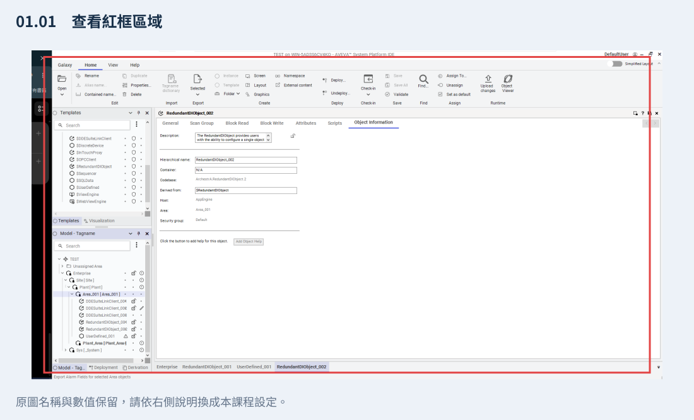

# 從實際 IDE 找到各物件

進階 / modbus

## 學習目標
- 能用自己的話說明「從實際 IDE 找到各物件」的主要角色或資料關係。
- 能辨認本課常見誤解，並說明應查驗的資料或證據。

## 前置能力
先完成平台、圖控與 AHU 基礎，或回查本課前置觀念。

## 原教材重點
- 先分清範本、實例與中央編輯器，再沿資料流設定。
- 左上 Templates 放共用範本，像 C# Class。
- 左下 Model 放設備與通訊實例，像已建立的物件。
- 中央顯示目前開啟物件；選取與開啟是不同動作。
- Deployment 檢查電腦與引擎，Derivation 檢查範本來源。

## 圖文對照

使用者提供：System Platform IDE 全覽

## 常見問題
### 這一課應先掌握什麼？
先分清範本、實例與中央編輯器，再沿資料流設定。

### Galaxy Repository 主要保存什麼？
工程組態與專案物件設定。組態與設備歷史資料屬不同責任，備份與查詢方式也不同。

### IDE 與 AppEngine 的基本差別為何？
IDE 編輯工程，AppEngine 執行已部署物件。設計環境與執行環境需分清，排錯才能找對位置。

## 記憶卡
- 問：Model View 與 Deployment View 分別適合看什麼？
  答：邏輯分類與實際部署位置。同一物件可從工程分類及執行拓樸兩種角度觀察。
- 問：在 IDE 看得到物件，就代表已在執行嗎？
  答：還需確認指派、部署與執行狀態。設計時建立物件並不等於它已部署至正確 Engine。
- 問：Area 的規劃應依什麼安排？
  答：專案設備或區域的管理需求。工程分類需能協助維護、警報範圍與設備定位。

## 實作與學習紀錄
以本課原教材的案例，記錄一項正常情境與一項異常情境，分別寫下預期結果、實際證據及待確認事項。

- 我的說明：
- 預期與實際結果：
- 待確認問題：

## 課後五題測驗

1. 下列哪項符合本課的教材重點？
   A. 先分清範本、實例與中央編輯器，再沿資料流設定。
   B. 所有設備的完整歷史曲線
   C. 電腦的每個使用者文件

2. 複習本課的操作與判讀原則，哪一項正確？
   A. AppEngine 只是圖片瀏覽器
   B. 左上 Templates 放共用範本，像 C# Class。
   C. IDE 就是所有現場控制器

3. Model View 與 Deployment View 分別適合看什麼？
   A. 兩者只差字型顏色
   B. 兩者都只顯示歷史趨勢
   C. 邏輯分類與實際部署位置

4. Area 的規劃應依什麼安排？
   A. 每張圖片任意取名即可
   B. 專案設備或區域的管理需求
   C. 以使用者密碼作為分類

5. IDE 與 AppEngine 的基本差別為何？
   A. IDE 就是所有現場控制器
   B. AppEngine 只是圖片瀏覽器
   C. IDE 編輯工程，AppEngine 執行已部署物件

## 答案與解析
1. A：本課原教材重點：先分清範本、實例與中央編輯器，再沿資料流設定。
2. B：本課原教材重點：左上 Templates 放共用範本，像 C# Class。
3. C：同一物件可從工程分類及執行拓樸兩種角度觀察。
4. B：工程分類需能協助維護、警報範圍與設備定位。
5. C：設計環境與執行環境需分清，排錯才能找對位置。

## 原教材
https://chermanyen.github.io/fmcs-academy/courses/modbus/index.html#topic-3
概念與練習沿用本站原教材；版本、來源圖及限制仍以原教材標示為準。
