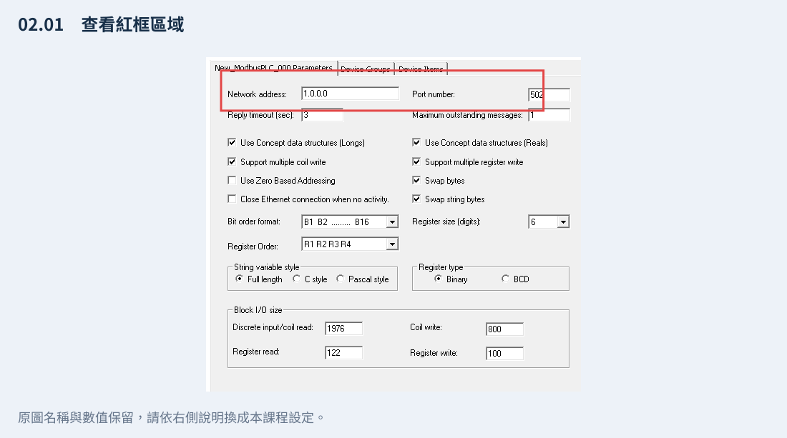

# 實驗架構與設備分工

進階 / modbus

## 學習目標
- 能用自己的話說明「實驗架構與設備分工」的主要角色或資料關係。
- 能辨認本課常見誤解，並說明應查驗的資料或證據。

## 前置能力
先完成平台、圖控與 AHU 基礎，或回查本課前置觀念。

## 原教材重點
- 單一 PLC 加兩台 OI Server，練習通訊來源備援。
- PLC：192.168.10.10，Modbus TCP Server，Port 502。
- 主要 OI Server：192.168.10.21；備用：192.168.10.22。
- DI_Primary、DI_Backup 透過 SuiteLink 連接各自 OI 來源。
- DI_Redundant 統一提供資料，AHU_001 再供 InTouch 與 Historian 使用。

## 圖文對照

AVEVA MBTCP Driver 手冊，2023，PDF p.39

## 常見問題
### 這一課應先掌握什麼？
單一 PLC 加兩台 OI Server，練習通訊來源備援。

### AHU 在本教材代表哪類設備？
空氣處理機或空調箱。AHU 處理及輸送空氣，常包含濾網、盤管與風機。

### 送風溫度與回風溫度應如何建點？
分成不同點位並各自標明單位與位置。量測位置不同就代表不同物理意義，點位表須分別描述。

## 記憶卡
- 問：風機收到啟動命令後，能否直接當作已運轉？
  答：還要核對運轉回授。命令是要求，回授才是實際狀態，兩者需分開呈現。
- 問：濾網壓差資料的用途為何？
  答：協助判讀濾網與氣流狀況。壓差是設備狀態的線索，門檻與保養決策仍依工程規格及現場程序。
- 問：兩台 AHU 使用共用圖形時，最應核對什麼？
  答：各自的設備參照與資料來源。共用外觀可重用，但設備實例與來源參照必須保持獨立。

## 實作與學習紀錄
以本課原教材的案例，記錄一項正常情境與一項異常情境，分別寫下預期結果、實際證據及待確認事項。

- 我的說明：
- 預期與實際結果：
- 待確認問題：

## 課後五題測驗

1. 下列哪項符合本課的教材重點？
   A. 電力計費軟體
   B. 單一 PLC 加兩台 OI Server，練習通訊來源備援。
   C. 資料庫備份工具

2. 複習本課的操作與判讀原則，哪一項正確？
   A. 由畫面顏色自動推算
   B. PLC：192.168.10.10，Modbus TCP Server，Port 502。
   C. 共用同一個值即可

3. AHU 在本教材代表哪類設備？
   A. 電力計費軟體
   B. 資料庫備份工具
   C. 空氣處理機或空調箱

4. 風機收到啟動命令後，能否直接當作已運轉？
   A. 只有歷史資料能判斷
   B. 命令發出就保證運轉
   C. 還要核對運轉回授

5. 兩台 AHU 使用共用圖形時，最應核對什麼？
   A. 把兩台都綁到同一個測試點
   B. 各自的設備參照與資料來源
   C. 只換設備標題即可

## 答案與解析
1. B：本課原教材重點：單一 PLC 加兩台 OI Server，練習通訊來源備援。
2. B：本課原教材重點：PLC：192.168.10.10，Modbus TCP Server，Port 502。
3. C：AHU 處理及輸送空氣，常包含濾網、盤管與風機。
4. C：命令是要求，回授才是實際狀態，兩者需分開呈現。
5. B：共用外觀可重用，但設備實例與來源參照必須保持獨立。

## 原教材
https://chermanyen.github.io/fmcs-academy/courses/modbus/index.html#topic-4
概念與練習沿用本站原教材；版本、來源圖及限制仍以原教材標示為準。
