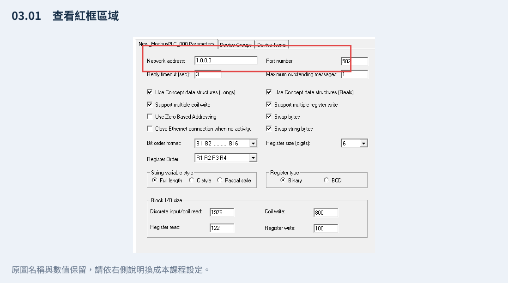

# 點位表：位址、型別與縮放

進階 / modbus

## 學習目標
- 能用自己的話說明「點位表：位址、型別與縮放」的主要角色或資料關係。
- 能辨認本課常見誤解，並說明應查驗的資料或證據。

## 前置能力
先完成平台、圖控與 AHU 基礎，或回查本課前置觀念。

## 原教材重點
- 先採 16-bit 原始整數，降低 Float 字序造成的混淆。
- Holding Register offset 0：230，區域溫度 23.0°C。
- Holding Register offset 1：185，送風溫度 18.5°C。
- Holding Register offset 2：150，濾網壓差 150 Pa。
- Discrete Input offset 0／1：風機運轉／故障回授。

## 圖文對照

AVEVA MBTCP Driver 手冊，2023，PDF p.39

## 常見問題
### 這一課應先掌握什麼？
先採 16-bit 原始整數，降低 Float 字序造成的混淆。

### 設計溫度 Attribute 時，除了名稱還要定義什麼？
型別、單位、來源、範圍與讀寫方向。屬性定義需足以支援採集、畫面、警報及驗收。

### 外部輸入與衍生計算值應如何區分？
記錄各自來源及計算規則。區分原始輸入與衍生值，才能追查縮放或計算問題。

## 記憶卡
- 問：點位命名應優先滿足哪項需求？
  答：能辨認設備、用途並符合專案規範。命名需支援定位及維護，還要搭配完整點位規格。
- 問：只改屬性名稱，畫面資料綁定會一定正確嗎？
  答：還需檢查引用及部署影響。依名稱建立的引用可能受變更影響，應列入回歸驗收。
- 問：狀態值與控制命令為何要分開建欄位？
  答：命令是要求，狀態是實際回授。責任分清可避免操作人員把發令成功誤判成設備已動作。

## 實作與學習紀錄
以本課原教材的案例，記錄一項正常情境與一項異常情境，分別寫下預期結果、實際證據及待確認事項。

- 我的說明：
- 預期與實際結果：
- 待確認問題：

## 課後五題測驗

1. 下列哪項符合本課的教材重點？
   A. 先採 16-bit 原始整數，降低 Float 字序造成的混淆。
   B. 只定義文字顏色
   C. 只填維護人姓名

2. 複習本課的操作與判讀原則，哪一項正確？
   A. 全部用同一名稱覆蓋
   B. 一律不保留來源
   C. Holding Register offset 0：230，區域溫度 23.0°C。

3. 只改屬性名稱，畫面資料綁定會一定正確嗎？
   A. 還需檢查引用及部署影響
   B. 名稱相似就會自動正確
   C. 畫面標題會自動代替參照

4. 設計溫度 Attribute 時，除了名稱還要定義什麼？
   A. 只定義文字顏色
   B. 型別、單位、來源、範圍與讀寫方向
   C. 只填維護人姓名

5. 點位命名應優先滿足哪項需求？
   A. 名稱越長越好
   B. 與其他設備完全重複
   C. 能辨認設備、用途並符合專案規範

## 答案與解析
1. A：本課原教材重點：先採 16-bit 原始整數，降低 Float 字序造成的混淆。
2. C：本課原教材重點：Holding Register offset 0：230，區域溫度 23.0°C。
3. A：依名稱建立的引用可能受變更影響，應列入回歸驗收。
4. B：屬性定義需足以支援採集、畫面、警報及驗收。
5. C：命名需支援定位及維護，還要搭配完整點位規格。

## 原教材
https://chermanyen.github.io/fmcs-academy/courses/modbus/index.html#topic-5
概念與練習沿用本站原教材；版本、來源圖及限制仍以原教材標示為準。
