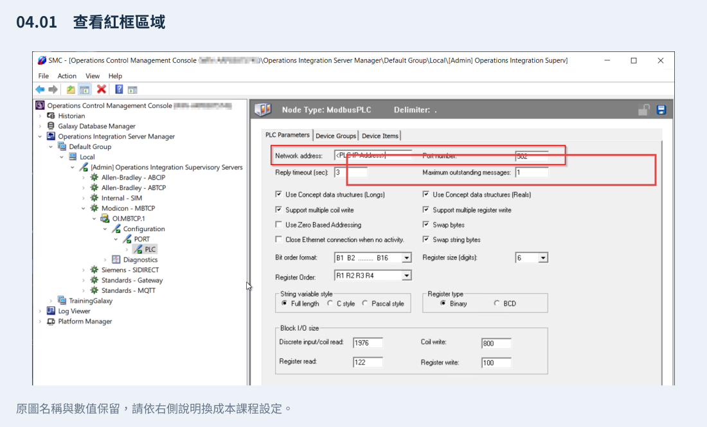

# 先讓 OI MBTCP 單路讀值成功

進階 / modbus

## 學習目標
- 能用自己的話說明「先讓 OI MBTCP 單路讀值成功」的主要角色或資料關係。
- 能辨認本課常見誤解，並說明應查驗的資料或證據。

## 前置能力
先完成平台、圖控與 AHU 基礎，或回查本課前置觀念。

## 原教材重點
- 對照 MBTCP 驅動的 PLC Parameters 與 Device Groups。不同 PLC 節點會顯示不同選項。
- 於管理控制台的 OI Server Manager 找到已安裝的 MBTCP 驅動。
- 依驅動節點結構新增 PLC，填 IP、TCP Port 與 PLC 規範的 Unit ID。
- 設定定址方式、資料型別與必要的 Byte／Word Order。
- 建立 Device Group：AHU_PLC，練習更新率可先用 1000 ms。
- 啟用驅動，用診斷工具讀 Holding Register 原始值 230。

## 圖文對照

InSource 技術文章：MBTCP PLC Parameters，公開畫面

## 常見問題
### 這一課應先掌握什麼？
對照 MBTCP 驅動的 PLC Parameters 與 Device Groups。不同 PLC 節點會顯示不同選項。

### Modbus 位址對應出現整體偏移時，先查什麼？
驅動定址方式及 0-based／1-based 規則。不同工具的表示法可能不同，須以驅動設定與設備手冊對照。

### 原始值 230 在規格中代表 23.0°C，應怎麼處理？
在指定的一層做十分之一縮放。工程值規則需唯一且可追溯，否則容易得到 2.3 或 230 等錯值。

## 記憶卡
- 問：Modbus TCP 與 SuiteLink 在本路線的分工為何？
  答：Modbus TCP 連 PLC，SuiteLink 連 OI 與平台。兩種通訊處於不同區段，排錯時要分段核對。
- 問：Modbus 回傳值異常但網路可達，還要核對什麼？
  答：暫存器種類、位址、資料型別與字序。能收到回應不代表解碼正確，資料定義也需要一致。
- 問：範例中的 PLC IP 或埠號應如何使用？
  答：先依專案及設備文件核對實際設定。教材參數是練習環境的一部分，不能視為現場通用設定。

## 實作與學習紀錄
以本課原教材的案例，記錄一項正常情境與一項異常情境，分別寫下預期結果、實際證據及待確認事項。

- 我的說明：
- 預期與實際結果：
- 待確認問題：

## 課後五題測驗

1. 下列哪項符合本課的教材重點？
   A. 先調整圖控顏色
   B. 先把所有值除以十
   C. 對照 MBTCP 驅動的 PLC Parameters 與 Device Groups。不同 PLC 節點會顯示不同選項。

2. 複習本課的操作與判讀原則，哪一項正確？
   A. 每一層都除以十
   B. 於管理控制台的 OI Server Manager 找到已安裝的 MBTCP 驅動。
   C. 直接把單位改成 °C 即可

3. Modbus 位址對應出現整體偏移時，先查什麼？
   A. 先調整圖控顏色
   B. 先把所有值除以十
   C. 驅動定址方式及 0-based／1-based 規則

4. 範例中的 PLC IP 或埠號應如何使用？
   A. 只改畫面標題即可
   B. 直接複製到所有生產設備
   C. 先依專案及設備文件核對實際設定

5. Modbus 回傳值異常但網路可達，還要核對什麼？
   A. 暫存器種類、位址、資料型別與字序
   B. 只核對電腦桌布
   C. 把警報門檻全部提高

## 答案與解析
1. C：本課原教材重點：對照 MBTCP 驅動的 PLC Parameters 與 Device Groups。不同 PLC 節點會顯示不同選項。
2. B：本課原教材重點：於管理控制台的 OI Server Manager 找到已安裝的 MBTCP 驅動。
3. C：不同工具的表示法可能不同，須以驅動設定與設備手冊對照。
4. C：教材參數是練習環境的一部分，不能視為現場通用設定。
5. A：能收到回應不代表解碼正確，資料定義也需要一致。

## 原教材
https://chermanyen.github.io/fmcs-academy/courses/modbus/index.html#topic-6
概念與練習沿用本站原教材；版本、來源圖及限制仍以原教材標示為準。
