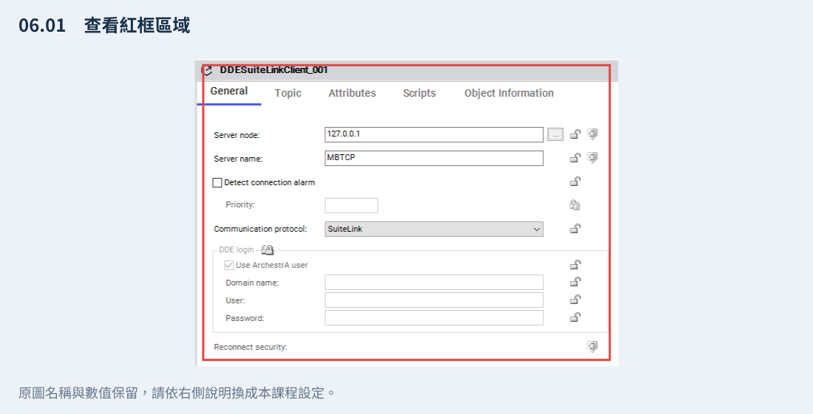

# Topic 與兩個 DI 來源

進階 / modbus

## 學習目標
- 能用自己的話說明「Topic 與兩個 DI 來源」的主要角色或資料關係。
- 能辨認本課常見誤解，並說明應查驗的資料或證據。

## 前置能力
先完成平台、圖控與 AHU 基礎，或回查本課前置觀念。

## 原教材重點
- Topic 是 SuiteLink 對外讀取範圍，對應 OI 的 Device Group。
- 從 $DDESuiteLinkClient 建立所需衍生模板與 DI_Primary、DI_Backup 實例。
- 在 General 指定各自來源電腦，在 Topic 頁配置 AHU_PLC。
- 兩台 OI 使用相同群組名稱、點位命名與資料意義。
- 完成指派、簽入與部署後，分別驗證兩條來源都能讀到 230。

## 圖文對照

使用者提供：DDESuiteLinkClient General

## 常見問題
### 這一課應先掌握什麼？
Topic 是 SuiteLink 對外讀取範圍，對應 OI 的 Device Group。

### DDESuiteLinkClient 的 Server node 在本路線指向哪裡？
執行 I/O Server 的電腦。OI 到平台與 PLC 到 OI 是不同區段，應分別設定。

### SuiteLink Topic 通常要與什麼對照？
OI 對外的 Device Group。Topic 與來源群組不一致，可能無法取得預期項目。

## 記憶卡
- 問：設定 Server node 後，PLC 連線設定會自動正確嗎？
  答：仍需在 OI 驅動核對 PLC 參數。平台到 OI 的設定不能取代 OI 到 PLC 的配置。
- 問：主要與備用 DI 來源應如何驗證？
  答：先各自單獨讀值成功，再驗證共同入口。單路基線有助於判斷備援問題來自哪一段。
- 問：Topic 名稱可以只看教材後直接照抄嗎？
  答：需與實際 OI 群組名稱及專案規劃一致。來源與用戶端需使用一致且已驗證的命名。

## 實作與學習紀錄
以本課原教材的案例，記錄一項正常情境與一項異常情境，分別寫下預期結果、實際證據及待確認事項。

- 我的說明：
- 預期與實際結果：
- 待確認問題：

## 課後五題測驗

1. 下列哪項符合本課的教材重點？
   A. Topic 是 SuiteLink 對外讀取範圍，對應 OI 的 Device Group。
   B. 一律填 PLC 位址
   C. 一律填歷史資料庫名稱

2. 複習本課的操作與判讀原則，哪一項正確？
   A. Windows 使用者桌布
   B. 從 $DDESuiteLinkClient 建立所需衍生模板與 DI_Primary、DI_Backup 實例。
   C. 視窗標題字型

3. SuiteLink Topic 通常要與什麼對照？
   A. OI 對外的 Device Group
   B. 視窗標題字型
   C. Windows 使用者桌布

4. DDESuiteLinkClient 的 Server node 在本路線指向哪裡？
   A. 一律填歷史資料庫名稱
   B. 一律填 PLC 位址
   C. 執行 I/O Server 的電腦

5. Topic 名稱可以只看教材後直接照抄嗎？
   A. 需與實際 OI 群組名稱及專案規劃一致
   B. 只要包含數字就可以
   C. 任何名字都會自動對應

## 答案與解析
1. A：本課原教材重點：Topic 是 SuiteLink 對外讀取範圍，對應 OI 的 Device Group。
2. B：本課原教材重點：從 $DDESuiteLinkClient 建立所需衍生模板與 DI_Primary、DI_Backup 實例。
3. A：Topic 與來源群組不一致，可能無法取得預期項目。
4. C：OI 到平台與 PLC 到 OI 是不同區段，應分別設定。
5. A：來源與用戶端需使用一致且已驗證的命名。

## 原教材
https://chermanyen.github.io/fmcs-academy/courses/modbus/index.html#topic-8
概念與練習沿用本站原教材；版本、來源圖及限制仍以原教材標示為準。
