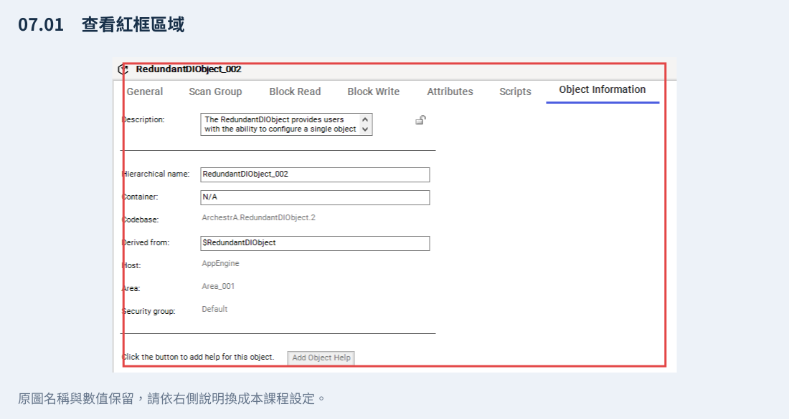

# RedundantDIObject：先辨認物件

進階 / modbus

## 學習目標
- 能用自己的話說明「RedundantDIObject：先辨認物件」的主要角色或資料關係。
- 能辨認本課常見誤解，並說明應查驗的資料或證據。

## 前置能力
先完成平台、圖控與 AHU 基礎，或回查本課前置觀念。

## 原教材重點
- DI 在此為 Device Integration，備援對象是通訊資料來源。
- Derived from 顯示 $RedundantDIObject，確認範本來源。
- Host 顯示 AppEngine，Area 顯示 Area_001。
- General 設主要／備用來源；Scan Group 設共同掃描群組。
- Attributes 用來查看物件屬性，執行狀態另用 Object Viewer。

## 圖文對照

使用者提供：RedundantDIObject Object Information

## 常見問題
### 這一課應先掌握什麼？
DI 在此為 Device Integration，備援對象是通訊資料來源。

### 兩台 OI Server 共用一台 PLC，仍可能有什麼風險？
共用 PLC 或其他共同節點仍是單點。備援只能降低其涵蓋範圍的故障，不能消除所有共同依賴。

### 主要來源故障時，判定備用接手需要看什麼？
有效來源、值、品質、時間及切換耗時。資料仍可用才是切換成效的核心，需保留驗收證據。

## 記憶卡
- 問：主來源恢復後，可以預設一定自動回切嗎？
  答：需依實際設定與版本驗證。切換與回切策略不同，不能用教材模擬取代產品設定。
- 問：RedundantDIObject 的備援對象主要是什麼？
  答：Device Integration 資料來源。RDI 依配置協調來源，仍需驗證底層驅動與共同執行環境。
- 問：兩條路徑都失去同一台 PLC 時，應怎麼呈現？
  答：顯示資料無效並依程序處理。共同來源故障可能同時影響兩路，畫面須避免誤導。

## 實作與學習紀錄
以本課原教材的案例，記錄一項正常情境與一項異常情境，分別寫下預期結果、實際證據及待確認事項。

- 我的說明：
- 預期與實際結果：
- 待確認問題：

## 課後五題測驗

1. 下列哪項符合本課的教材重點？
   A. 任何故障都可自動補救
   B. 只要有兩個圖示就沒有風險
   C. DI 在此為 Device Integration，備援對象是通訊資料來源。

2. 複習本課的操作與判讀原則，哪一項正確？
   A. 只看燈號改色
   B. Derived from 顯示 $RedundantDIObject，確認範本來源。
   C. 只看備用電腦開著

3. 主要來源故障時，判定備用接手需要看什麼？
   A. 只看備用電腦開著
   B. 有效來源、值、品質、時間及切換耗時
   C. 只看燈號改色

4. 主來源恢復後，可以預設一定自動回切嗎？
   A. 所有系統一定立即回切
   B. 永遠不可能回切
   C. 需依實際設定與版本驗證

5. 兩台 OI Server 共用一台 PLC，仍可能有什麼風險？
   A. 只要有兩個圖示就沒有風險
   B. 共用 PLC 或其他共同節點仍是單點
   C. 任何故障都可自動補救

## 答案與解析
1. C：本課原教材重點：DI 在此為 Device Integration，備援對象是通訊資料來源。
2. B：本課原教材重點：Derived from 顯示 $RedundantDIObject，確認範本來源。
3. B：資料仍可用才是切換成效的核心，需保留驗收證據。
4. C：切換與回切策略不同，不能用教材模擬取代產品設定。
5. B：備援只能降低其涵蓋範圍的故障，不能消除所有共同依賴。

## 原教材
https://chermanyen.github.io/fmcs-academy/courses/modbus/index.html#topic-9
概念與練習沿用本站原教材；版本、來源圖及限制仍以原教材標示為準。
