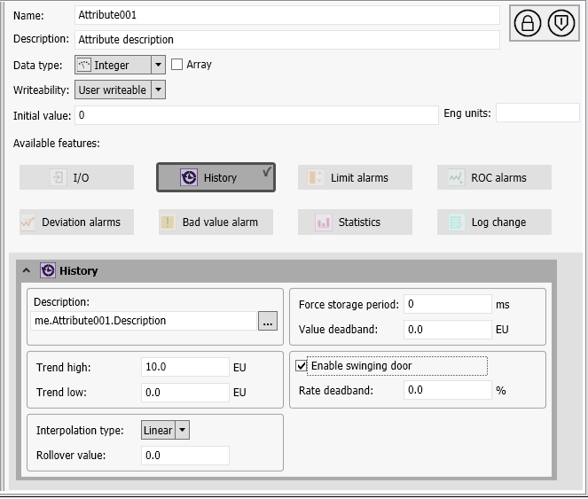

# 實作 6｜處理即時值與歷史資料

進階 / onboarding

## 學習目標
- 能用自己的話說明「實作 6｜處理即時值與歷史資料」的主要角色或資料關係。
- 能辨認本課常見誤解，並說明應查驗的資料或證據。

## 前置能力
先完成平台、圖控與 AHU 基礎，或回查本課前置觀念。

## 原教材重點
- 即時值用來看設備現在的狀態。歷史資料用來重建趨勢，至少要能辨識設備、點位、時間、值與品質。
- 模擬記錄三筆送風溫度與一筆品質不良事件。
- 在測試 SQL 或 Historian 查詢一段時間內的資料，核對時間排序與品質。
- 說明 Script 可處理衍生值，MXAccess 用於平台執行時資料存取。
- 能從樣本追溯一次高溫發生及恢復的時間。

## 圖文對照

沿用相關教材畫面輔助辨認本課角色與設定位置，非本課的實測結果；介面及欄位依版本不同。

## 常見問題
### 這一課應先掌握什麼？
即時值用來看設備現在的狀態。歷史資料用來重建趨勢，至少要能辨識設備、點位、時間、值與品質。

### 即時值與歷史資料的主要差別為何？
即時值描述當下，歷史資料保存時間變化。追查事件需要保存過去樣本及其時間與品質。

### 放入趨勢元件，就代表資料已被收集嗎？
仍需確認收集設定、服務及查詢結果。畫面元件與後端收集是不同環節，必須分別驗證。

## 記憶卡
- 問：查詢某次事件的歷史資料時，應先確認什麼？
  答：點位、時間區間、時區及品質。資料選取範圍與時間基準會直接影響判讀。
- 問：歷史曲線出現缺值，適合怎麼處理？
  答：保留缺值意義並追查通訊或收集狀態。缺值可能是重要證據，補值或重取樣需有明確規則。
- 問：Historian 與 Galaxy Repository 的責任為何？
  答：前者處理設備歷史，後者保存工程組態。組態、時間序列與自建業務資料庫應分別管理。

## 實作與學習紀錄
以本課原教材的案例，記錄一項正常情境與一項異常情境，分別寫下預期結果、實際證據及待確認事項。

- 我的說明：
- 預期與實際結果：
- 待確認問題：

## 課後五題測驗

1. 下列哪項符合本課的教材重點？
   A. 歷史資料就是現在畫面截圖
   B. 即時值用來看設備現在的狀態。歷史資料用來重建趨勢，至少要能辨識設備、點位、時間、值與品質。
   C. 即時值可自動還原所有過去

2. 複習本課的操作與判讀原則，哪一項正確？
   A. 模擬記錄三筆送風溫度與一筆品質不良事件。
   B. 只要圖上有坐標軸即可
   C. 有元件就一定有全部歷史

3. 歷史曲線出現缺值，適合怎麼處理？
   A. 任意補成正常值而不標示
   B. 保留缺值意義並追查通訊或收集狀態
   C. 刪除整段事件紀錄

4. 放入趨勢元件，就代表資料已被收集嗎？
   A. 仍需確認收集設定、服務及查詢結果
   B. 只要圖上有坐標軸即可
   C. 有元件就一定有全部歷史

5. Historian 與 Galaxy Repository 的責任為何？
   A. 兩者都只是圖形編輯器
   B. 前者處理設備歷史，後者保存工程組態
   C. 兩者資料可以任意互改

## 答案與解析
1. B：本課原教材重點：即時值用來看設備現在的狀態。歷史資料用來重建趨勢，至少要能辨識設備、點位、時間、值與品質。
2. A：本課原教材重點：模擬記錄三筆送風溫度與一筆品質不良事件。
3. B：缺值可能是重要證據，補值或重取樣需有明確規則。
4. A：畫面元件與後端收集是不同環節，必須分別驗證。
5. B：組態、時間序列與自建業務資料庫應分別管理。

## 原教材
https://chermanyen.github.io/fmcs-academy/courses/onboarding/index.html#lesson-6
概念與練習沿用本站原教材；版本、來源圖及限制仍以原教材標示為準。
