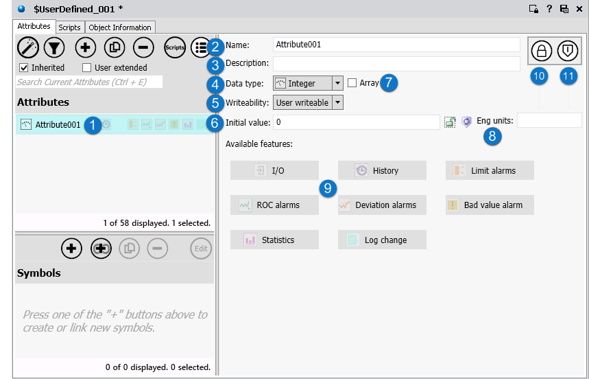

# AHU 欄位對照與範本

進階 / onboarding

## 學習目標
- 能用自己的話說明「AHU 欄位對照與範本」的主要角色或資料關係。
- 能辨認本課常見誤解，並說明應查驗的資料或證據。

## 前置能力
先完成平台、圖控與 AHU 基礎，或回查本課前置觀念。

## 原教材重點
- 第 3 週先建欄位，第 4 週填入來源，第 5 週用同一張表核對圖控。
- AttributeData Type單位初值來源示意圖控參照
- SupplyTempFloat°C24Simulation.AHU001.TemperatureAHU001.SupplyTemp
- ReturnTempFloat°C27Simulation.AHU001.ReturnTemperatureAHU001.ReturnTemp
- FanRunBoolean—TrueSimulation.AHU001.FanRunAHU001.FanRun
- Simulation.AHU001.Temperature 是練習用邏輯名稱。實機請分別記錄 OPC UA 瀏覽取得的 NodeId，以及依所用驅動與 I/O 物件設定取得的 InputSource。
- 如何準備並驗證 .aaPKG 範本
- 目前可下載欄位表。可匯入的 .aaPKG 待從已驗證的 AVEVA 訓練 Galaxy 匯出。
- 在來源測試 Galaxy 確認既有的 $AHU_Training 範本與 AHU001 實例已 Check In。以 IDE 的物件匯出功能建立套件，記錄來源版本及所需相依範本。
- 在獨立測試 Galaxy 先建立回復點。從 IDE 的 Import → Objects → Objects from package 選取套件，先檢查重名與匯入偏好。
- 匯入後檢查物件、欄位與型別，重新核對目標宿主與 I/O 參照。部署後在 Object Viewer 驗證讀值，再進行第 5 週圖控練習。

## 圖文對照

沿用相關教材畫面輔助辨認本課角色與設定位置，非本課的實測結果；介面及欄位依版本不同。

## 常見問題
### 這一課應先掌握什麼？
第 3 週先建欄位，第 4 週填入來源，第 5 週用同一張表核對圖控。

### 設計溫度 Attribute 時，除了名稱還要定義什麼？
型別、單位、來源、範圍與讀寫方向。屬性定義需足以支援採集、畫面、警報及驗收。

### 外部輸入與衍生計算值應如何區分？
記錄各自來源及計算規則。區分原始輸入與衍生值，才能追查縮放或計算問題。

## 記憶卡
- 問：點位命名應優先滿足哪項需求？
  答：能辨認設備、用途並符合專案規範。命名需支援定位及維護，還要搭配完整點位規格。
- 問：只改屬性名稱，畫面資料綁定會一定正確嗎？
  答：還需檢查引用及部署影響。依名稱建立的引用可能受變更影響，應列入回歸驗收。
- 問：狀態值與控制命令為何要分開建欄位？
  答：命令是要求，狀態是實際回授。責任分清可避免操作人員把發令成功誤判成設備已動作。

## 實作與學習紀錄
以本課原教材的案例，記錄一項正常情境與一項異常情境，分別寫下預期結果、實際證據及待確認事項。

- 我的說明：
- 預期與實際結果：
- 待確認問題：

## 課後五題測驗

1. 下列哪項符合本課的教材重點？
   A. 只填維護人姓名
   B. 只定義文字顏色
   C. 第 3 週先建欄位，第 4 週填入來源，第 5 週用同一張表核對圖控。

2. 複習本課的操作與判讀原則，哪一項正確？
   A. 一律不保留來源
   B. AttributeData Type單位初值來源示意圖控參照
   C. 全部用同一名稱覆蓋

3. 只改屬性名稱，畫面資料綁定會一定正確嗎？
   A. 還需檢查引用及部署影響
   B. 畫面標題會自動代替參照
   C. 名稱相似就會自動正確

4. 設計溫度 Attribute 時，除了名稱還要定義什麼？
   A. 型別、單位、來源、範圍與讀寫方向
   B. 只填維護人姓名
   C. 只定義文字顏色

5. 點位命名應優先滿足哪項需求？
   A. 名稱越長越好
   B. 與其他設備完全重複
   C. 能辨認設備、用途並符合專案規範

## 答案與解析
1. C：本課原教材重點：第 3 週先建欄位，第 4 週填入來源，第 5 週用同一張表核對圖控。
2. B：本課原教材重點：AttributeData Type單位初值來源示意圖控參照
3. A：依名稱建立的引用可能受變更影響，應列入回歸驗收。
4. A：屬性定義需足以支援採集、畫面、警報及驗收。
5. C：命名需支援定位及維護，還要搭配完整點位規格。

## 原教材
https://chermanyen.github.io/fmcs-academy/courses/onboarding/index.html#topic-6
概念與練習沿用本站原教材；版本、來源圖及限制仍以原教材標示為準。
