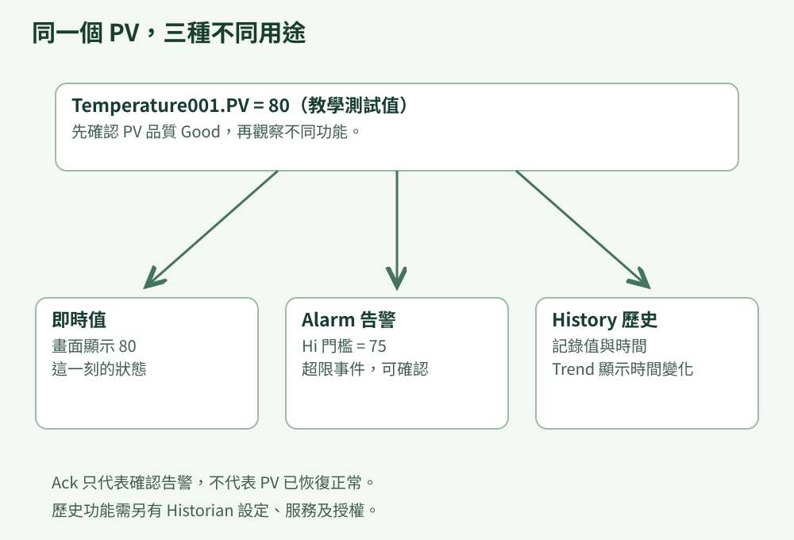

# Alarm、Trend 與 History

基礎 / platform

## 學習目標
- 能用自己的話說明「Alarm、Trend 與 History」的主要角色或資料關係。
- 能辨認本課常見誤解，並說明應查驗的資料或證據。

## 前置能力
先理解 FMCS 的資料流與監控分工。

## 原教材重點
- PV 是目前值；Alarm 是符合條件時產生的事件；History 是歷史紀錄。以下為教學練習，告警門檻不代表現場設計。
- 在測試 PV 啟用 Limit alarms，教材範例 LoLo 10、Lo 25、Hi 75、HiHi 90。
- 先將模擬值設 50，再提高至 80，觀察 Hi；提高至 95，觀察 HiHi。
- 觀察觸發、確認與恢復的差異；Ack 不代表製程已恢復正常。
- 啟用 History 前確認 Historian 服務、連線與授權；設定記錄策略後部署。
- 以固定間隔改變模擬值，在 Trend 比對時間戳、工程單位與資料品質。
- 2048 是連線驗證原始值；若直接套 90 的上限會立即觸發告警，應先完成縮放與門檻設計。
- 無歷史值？從物件品質、History 設定、Historian 服務、時間同步與授權逐一檢查。

## 圖文對照

原教材流程示意，非實際軟體截圖。

## 常見問題
### 這一課應先掌握什麼？
PV 是目前值；Alarm 是符合條件時產生的事件；History 是歷史紀錄。以下為教學練習，告警門檻不代表現場設計。

### 即時值與歷史資料的主要差別為何？
即時值描述當下，歷史資料保存時間變化。追查事件需要保存過去樣本及其時間與品質。

### 放入趨勢元件，就代表資料已被收集嗎？
仍需確認收集設定、服務及查詢結果。畫面元件與後端收集是不同環節，必須分別驗證。

## 記憶卡
- 問：查詢某次事件的歷史資料時，應先確認什麼？
  答：點位、時間區間、時區及品質。資料選取範圍與時間基準會直接影響判讀。
- 問：歷史曲線出現缺值，適合怎麼處理？
  答：保留缺值意義並追查通訊或收集狀態。缺值可能是重要證據，補值或重取樣需有明確規則。
- 問：Historian 與 Galaxy Repository 的責任為何？
  答：前者處理設備歷史，後者保存工程組態。組態、時間序列與自建業務資料庫應分別管理。

## 實作與學習紀錄
以本課原教材的案例，記錄一項正常情境與一項異常情境，分別寫下預期結果、實際證據及待確認事項。

- 我的說明：
- 預期與實際結果：
- 待確認問題：

## 課後五題測驗

1. 下列哪項符合本課的教材重點？
   A. 歷史資料就是現在畫面截圖
   B. 即時值可自動還原所有過去
   C. PV 是目前值；Alarm 是符合條件時產生的事件；History 是歷史紀錄。以下為教學練習，告警門檻不代表現場設計。

2. 複習本課的操作與判讀原則，哪一項正確？
   A. 在測試 PV 啟用 Limit alarms，教材範例 LoLo 10、Lo 25、Hi 75、HiHi 90。
   B. 只要圖上有坐標軸即可
   C. 有元件就一定有全部歷史

3. 查詢某次事件的歷史資料時，應先確認什麼？
   A. 點位、時間區間、時區及品質
   B. 只確認線條顏色
   C. 只查現在的最後值

4. 歷史曲線出現缺值，適合怎麼處理？
   A. 保留缺值意義並追查通訊或收集狀態
   B. 刪除整段事件紀錄
   C. 任意補成正常值而不標示

5. Historian 與 Galaxy Repository 的責任為何？
   A. 兩者都只是圖形編輯器
   B. 前者處理設備歷史，後者保存工程組態
   C. 兩者資料可以任意互改

## 答案與解析
1. C：本課原教材重點：PV 是目前值；Alarm 是符合條件時產生的事件；History 是歷史紀錄。以下為教學練習，告警門檻不代表現場設計。
2. A：本課原教材重點：在測試 PV 啟用 Limit alarms，教材範例 LoLo 10、Lo 25、Hi 75、HiHi 90。
3. A：資料選取範圍與時間基準會直接影響判讀。
4. A：缺值可能是重要證據，補值或重取樣需有明確規則。
5. B：組態、時間序列與自建業務資料庫應分別管理。

## 原教材
https://chermanyen.github.io/fmcs-academy/courses/platform/index.html#alarm
概念與練習沿用本站原教材；版本、來源圖及限制仍以原教材標示為準。
