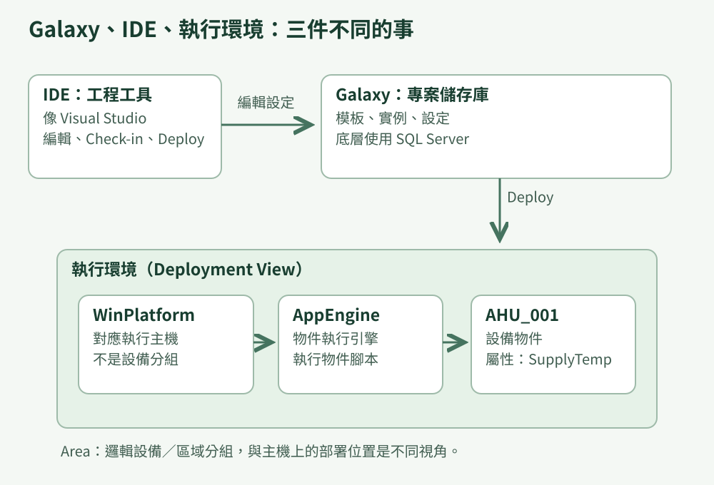

# Galaxy、IDE 與部署架構

基礎 / platform

## 學習目標
- 能用自己的話說明「Galaxy、IDE 與部署架構」的主要角色或資料關係。
- 能辨認本課常見誤解，並說明應查驗的資料或證據。

## 前置能力
先理解 FMCS 的資料流與監控分工。

## 原教材重點
- Galaxy 保存應用物件及設定，底層使用 SQL Server。WinPlatform 對應執行節點；AppEngine 承載物件執行；Area 用於組織設備與區域。
- 啟動 IDE，選擇測試 Galaxy 並開啟。
- 切換 Model、Deployment、Derivation 視圖，比較設備結構、部署位置與繼承關係。
- 在測試 Galaxy 找出 WinPlatform、AppEngine 與 Area。
- 記錄每個物件的 Host 與部署狀態，不要直接修改正式環境。
- Check-in 是將編輯提交回 Galaxy；Deploy 是將設定送至執行環境，兩者不同。
- 找不到基底模板？檢查建立 Galaxy 時使用的 CAB；Blank 與 Default Galaxy 所含內容不同。

## 圖文對照

原教材流程示意，非實際軟體截圖。

## 常見問題
### 這一課應先掌握什麼？
Galaxy 保存應用物件及設定，底層使用 SQL Server。WinPlatform 對應執行節點；AppEngine 承載物件執行；Area 用於組織設備與區域。

### 完成物件編輯後，為何還要驗證與部署？
工程變更需送至正確執行環境並核對結果。設計、簽入、部署與執行驗收是不同步驟。

### 部署失敗時，先保留哪種證據？
物件、節點、時間與完整錯誤訊息。具體上下文有助於判斷權限、依賴或版本等問題。

## 記憶卡
- 問：畫面顯示舊內容時，應先核對什麼？
  答：應用版本、部署目標與執行中的實例。可能開啟了不同應用或尚未部署更新，需先確認版本與位置。
- 問：正式變更前，回復方案需要做到什麼程度？
  答：能說明回復對象、步驟及驗證方法。部署需要可操作的回復方式，且最好先在測試環境演練。
- 問：部署顯示成功後，還要做什麼？
  答：驗證讀值、品質、警報及畫面行為。部署成功是工程狀態，功能是否符合需求仍需測試。

## 實作與學習紀錄
以本課原教材的案例，記錄一項正常情境與一項異常情境，分別寫下預期結果、實際證據及待確認事項。

- 我的說明：
- 預期與實際結果：
- 待確認問題：

## 課後五題測驗

1. 下列哪項符合本課的教材重點？
   A. 編輯器會取代所有 Engine
   B. Galaxy 保存應用物件及設定，底層使用 SQL Server。WinPlatform 對應執行節點；AppEngine 承載物件執行；Area 用於組織設備與區域。
   C. 儲存圖片就等於設備上線

2. 複習本課的操作與判讀原則，哪一項正確？
   A. 只截一張沒有名稱的空白圖
   B. 只記錄心情
   C. 啟動 IDE，選擇測試 Galaxy 並開啟。

3. 部署顯示成功後，還要做什麼？
   A. 直接刪除所有舊紀錄
   B. 不需再查看資料
   C. 驗證讀值、品質、警報及畫面行為

4. 完成物件編輯後，為何還要驗證與部署？
   A. 編輯器會取代所有 Engine
   B. 工程變更需送至正確執行環境並核對結果
   C. 儲存圖片就等於設備上線

5. 畫面顯示舊內容時，應先核對什麼？
   A. 只調整螢幕亮度
   B. 先改 PLC 所有位址
   C. 應用版本、部署目標與執行中的實例

## 答案與解析
1. B：本課原教材重點：Galaxy 保存應用物件及設定，底層使用 SQL Server。WinPlatform 對應執行節點；AppEngine 承載物件執行；Area 用於組織設備與區域。
2. C：本課原教材重點：啟動 IDE，選擇測試 Galaxy 並開啟。
3. C：部署成功是工程狀態，功能是否符合需求仍需測試。
4. B：設計、簽入、部署與執行驗收是不同步驟。
5. C：可能開啟了不同應用或尚未部署更新，需先確認版本與位置。

## 原教材
https://chermanyen.github.io/fmcs-academy/courses/platform/index.html#galaxy
概念與練習沿用本站原教材；版本、來源圖及限制仍以原教材標示為準。
