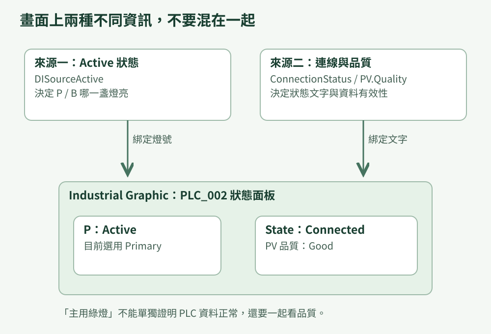

# InTouch 狀態面板

基礎 / platform

## 學習目標
- 能用自己的話說明「InTouch 狀態面板」的主要角色或資料關係。
- 能辨認本課常見誤解，並說明應查驗的資料或證據。

## 前置能力
先理解 FMCS 的資料流與監控分工。

## 原教材重點
- 依內部教材製作 Industrial Graphic 狀態燈與切換按鈕；本網站的互動面板為模擬，沒有連接公司設備。
- Visualization 新增 Graphic，畫出 PLC_002、P／B 指示燈、State 文字與 Redundant 按鈕。
- 燈號用 Fill Style Boolean，判斷 DISourceActive 是否等於對應 Client 的完整名稱。
- Value Display 綁定狀態屬性；教材此處為推測，須確認數值轉文字方式。
- 按鈕 Action Script 建議設定 RedundantDIObject_001.ForceFailoverCmd = true;，確認權限與本機屬性後才測試。
- Check-in Graphic，在測試 InTouch 視窗放入圖形；內部範例入口為 TestArea > CpuMonitor。
- 執行並驗證燈號、狀態文字、切換結果及斷線品質，避免把紅綠燈當作唯一判斷。
- Industrial Graphic 是可重用畫面元件；動畫是資料與外觀之間的綁定。
- 畫面值不更新？先檢查物件參照、部署狀態與資料品質，再查 Graphic 綁定。

## 圖文對照

原教材流程示意，非實際軟體截圖。

## 常見問題
### 這一課應先掌握什麼？
依內部教材製作 Industrial Graphic 狀態燈與切換按鈕；本網站的互動面板為模擬，沒有連接公司設備。

### WindowMaker 與 WindowViewer 的分工為何？
前者編輯畫面，後者執行畫面。開發與執行環境不同，排錯需先確認正在使用哪個應用。

### Industrial Graphic 最主要的維護價值為何？
重用外觀與綁定規格。圖形可以重用，但設備參照與狀態意義仍需逐一確認。

## 記憶卡
- 問：數值綁定完成後，最可靠的核對方式為何？
  答：比對來源、Object Viewer 與執行畫面。跨層比對可揭露誤綁設備、單位或縮放問題。
- 問：運轉燈與資料品質為何要分開呈現？
  答：設備狀態與資料可信度是不同訊息。停止但資料有效，與失聯而狀態未知，應有不同呈現。
- 問：受管理與獨立式 InTouch 的設定可否直接混用？
  答：應先確認應用類型與資料參照路線。受管理應用與獨立標籤路線的維護入口及參照方式可能不同。

## 實作與學習紀錄
以本課原教材的案例，記錄一項正常情境與一項異常情境，分別寫下預期結果、實際證據及待確認事項。

- 我的說明：
- 預期與實際結果：
- 待確認問題：

## 課後五題測驗

1. 下列哪項符合本課的教材重點？
   A. 兩者都是歷史資料庫
   B. 前者保存 PLC 程式，後者備份 SQL
   C. Visualization 新增 Graphic，畫出 PLC_002、P／B 指示燈、State 文字與 Redundant 按鈕。

2. 複習本課的操作與判讀原則，哪一項正確？
   A. 不需再核對設備來源
   B. 自動取代所有 PLC 控制
   C. 燈號用 Fill Style Boolean，判斷 DISourceActive 是否等於對應 Client 的完整名稱。

3. 運轉燈與資料品質為何要分開呈現？
   A. 只顯示燈號可省去所有驗證
   B. 設備狀態與資料可信度是不同訊息
   C. 綠色永遠表示全部正常

4. 受管理與獨立式 InTouch 的設定可否直接混用？
   A. 兩者所有設定完全相同
   B. 應先確認應用類型與資料參照路線
   C. 只要檔名相同就能互換

5. 數值綁定完成後，最可靠的核對方式為何？
   A. 只看畫面已有一個數字
   B. 只檢查圖形是否居中
   C. 比對來源、Object Viewer 與執行畫面

## 答案與解析
1. C：本課原教材重點：Visualization 新增 Graphic，畫出 PLC_002、P／B 指示燈、State 文字與 Redundant 按鈕。
2. C：本課原教材重點：燈號用 Fill Style Boolean，判斷 DISourceActive 是否等於對應 Client 的完整名稱。
3. B：停止但資料有效，與失聯而狀態未知，應有不同呈現。
4. B：受管理應用與獨立標籤路線的維護入口及參照方式可能不同。
5. C：跨層比對可揭露誤綁設備、單位或縮放問題。

## 原教材
https://chermanyen.github.io/fmcs-academy/courses/platform/index.html#intouch
概念與練習沿用本站原教材；版本、來源圖及限制仍以原教材標示為準。
