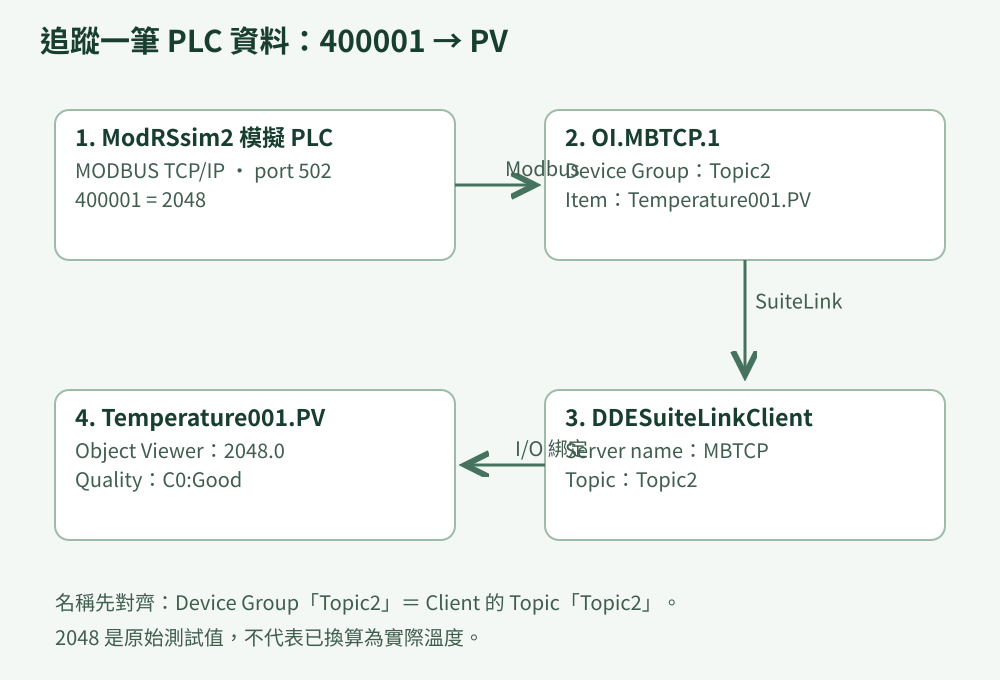

# 建立單一 PLC 連線

基礎 / platform

## 學習目標
- 能用自己的話說明「建立單一 PLC 連線」的主要角色或資料關係。
- 能辨認本課常見誤解，並說明應查驗的資料或證據。

## 前置能力
先理解 FMCS 的資料流與監控分工。

## 原教材重點
- 依內部教材建立 ModRSsim2 → OI.MBTCP.1 → DDESuiteLinkClient → Temperature001.PV 的測試鏈路。
- 啟動 ModRSsim2，選 MODBUS TCP/IP、port 502；Holding Register 400001 設 2048。
- OCMC → OI Server Manager → Modicon - MBTCP → OI.MBTCP.1，設定 TCPIP_PORT 與模擬器位址。
- 新增 Device Group Topic2，Update Interval 1000 ms；Device Item Temperature001.PV 對應 400001。
- 由 $DDESuiteLinkClient 建立測試 Client，Server node 127.0.0.1、Server name MBTCP、Protocol SuiteLink；新增 Topic2。
- 建立 $UserDefined 實例 Temperature001，新增 Float 屬性 PV 並啟用 I/O。
- IO Devices 視圖將物件連到 Client 的 Topic2；Check-in，先部署 Client，再部署 Temperature001。
- Object Viewer 檢查 PV = 2048、Quality = C0:Good；改模擬值，再觀察是否同步。
- 127.0.0.1 只適用本機測試；Device Group 與 Topic 名稱必須相符。400001 的地址表示法須依 Driver 驗證。
- Quality = Bad：依序檢查模擬器、port、Driver Activate、Topic2、Item Reference 與日誌。

## 圖文對照

原教材流程示意，非實際軟體截圖。

## 常見問題
### 這一課應先掌握什麼？
依內部教材建立 ModRSsim2 → OI.MBTCP.1 → DDESuiteLinkClient → Temperature001.PV 的測試鏈路。

### PLC 在資料路徑的主要工作是什麼？
讀取現場訊號並執行控制邏輯。PLC 接近現場設備，監控系統透過通訊取得其資料。

### PLC 與圖控的值不一致，應先如何確認？
逐層比對來源、通訊映射、平台與畫面。逐層核對可縮小問題範圍，避免以顯示修飾掩蓋來源錯誤。

## 記憶卡
- 問：連線測試通過，是否已證明點位正確？
  答：仍需核對位址、型別、值與品質。網路可達只驗證路徑的一部分，應用資料仍要獨立驗收。
- 問：第一個通訊實驗適合怎麼安排？
  答：先驗證一個唯讀模擬點。單點唯讀測試可降低干擾，建立可重現的資料驗證基線。
- 問：PLC 暫停更新而連線仍存在時，還應注意什麼？
  答：資料是否持續更新與是否有心跳機制。通訊連線與控制程式更新是不同層次，需依需求設計新鮮度驗證。

## 實作與學習紀錄
以本課原教材的案例，記錄一項正常情境與一項異常情境，分別寫下預期結果、實際證據及待確認事項。

- 我的說明：
- 預期與實際結果：
- 待確認問題：

## 課後五題測驗

1. 下列哪項符合本課的教材重點？
   A. 依內部教材建立 ModRSsim2 → OI.MBTCP.1 → DDESuiteLinkClient → Temperature001.PV 的測試鏈路。
   B. 只用來顯示網頁
   C. 保存所有公司文件

2. 複習本課的操作與判讀原則，哪一項正確？
   A. 啟動 ModRSsim2，選 MODBUS TCP/IP、port 502；Holding Register 400001 設 2048。
   B. 直接改畫面值讓兩者相同
   C. 先重裝全部軟體

3. 第一個通訊實驗適合怎麼安排？
   A. 先驗證一個唯讀模擬點
   B. 一次上線所有控制命令
   C. 直接改生產 PLC 程式

4. PLC 在資料路徑的主要工作是什麼？
   A. 讀取現場訊號並執行控制邏輯
   B. 保存所有公司文件
   C. 只用來顯示網頁

5. 連線測試通過，是否已證明點位正確？
   A. 只要主機可 ping 就正確
   B. 仍需核對位址、型別、值與品質
   C. 有 TCP 連線就全部正確

## 答案與解析
1. A：本課原教材重點：依內部教材建立 ModRSsim2 → OI.MBTCP.1 → DDESuiteLinkClient → Temperature001.PV 的測試鏈路。
2. A：本課原教材重點：啟動 ModRSsim2，選 MODBUS TCP/IP、port 502；Holding Register 400001 設 2048。
3. A：單點唯讀測試可降低干擾，建立可重現的資料驗證基線。
4. A：PLC 接近現場設備，監控系統透過通訊取得其資料。
5. B：網路可達只驗證路徑的一部分，應用資料仍要獨立驗收。

## 原教材
https://chermanyen.github.io/fmcs-academy/courses/platform/index.html#plc
概念與練習沿用本站原教材；版本、來源圖及限制仍以原教材標示為準。
