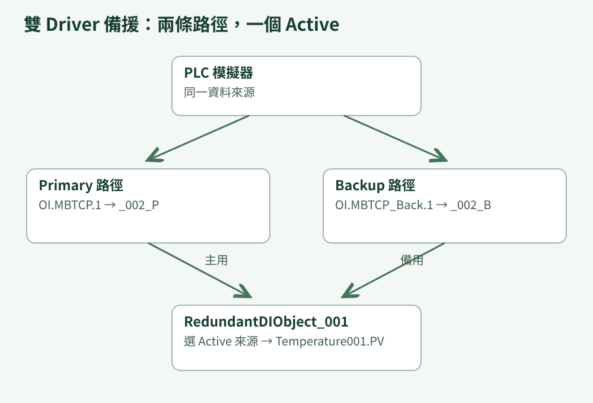

# 雙 Driver 備援

基礎 / platform

## 學習目標
- 能用自己的話說明「雙 Driver 備援」的主要角色或資料關係。
- 能辨認本課常見誤解，並說明應查驗的資料或證據。

## 前置能力
先理解 FMCS 的資料流與監控分工。

## 原教材重點
- 內部範例透過兩個 OI Server instance 與 RedundantDIObject 切換資料來源。同機雙 Driver 是通訊路徑練習，不能代表整台主機故障時仍可運作。
- 建立 OI.MBTCP_Back.1，複製 port、Topic2 與 Device Item 設定並 Activate。
- 建立 DDESuiteLinkClient_002_P 與 _002_B；Server name 分別 MBTCP 與 MBTCP_Back。
- 建立 RedundantDIObject_001，Primary／Backup DI source 指向上述完整實例名稱。
- Scan Group → Copy Common Scan Groups，選 Topic2；先部署兩個 Client，再部署備援物件。
- Undeploy Temperature001，重新連結 RedundantDIObject_001 的 Topic2，再 Deploy。
- Object Viewer 觀察 DISourceActive、DISourceStandby；在測試環境觸發 ForceFailoverCmd，確認 Active 改變與 PV 品質。
- Connected 表示通道連上；DISourceActive 才表示目前採用哪個來源。
- B 端 Disconnected：檢查 MBTCP_Back 名稱、Activate、Topic2、節點授權與 SuiteLink 加密錯誤。不要關閉安全設定來繞過錯誤。

## 圖文對照

原教材流程示意，非實際軟體截圖。

## 常見問題
### 這一課應先掌握什麼？
內部範例透過兩個 OI Server instance 與 RedundantDIObject 切換資料來源。同機雙 Driver 是通訊路徑練習，不能代表整台主機故障時仍可運作。

### 兩台 OI Server 共用一台 PLC，仍可能有什麼風險？
共用 PLC 或其他共同節點仍是單點。備援只能降低其涵蓋範圍的故障，不能消除所有共同依賴。

### 主要來源故障時，判定備用接手需要看什麼？
有效來源、值、品質、時間及切換耗時。資料仍可用才是切換成效的核心，需保留驗收證據。

## 記憶卡
- 問：主來源恢復後，可以預設一定自動回切嗎？
  答：需依實際設定與版本驗證。切換與回切策略不同，不能用教材模擬取代產品設定。
- 問：RedundantDIObject 的備援對象主要是什麼？
  答：Device Integration 資料來源。RDI 依配置協調來源，仍需驗證底層驅動與共同執行環境。
- 問：兩條路徑都失去同一台 PLC 時，應怎麼呈現？
  答：顯示資料無效並依程序處理。共同來源故障可能同時影響兩路，畫面須避免誤導。

## 實作與學習紀錄
以本課原教材的案例，記錄一項正常情境與一項異常情境，分別寫下預期結果、實際證據及待確認事項。

- 我的說明：
- 預期與實際結果：
- 待確認問題：

## 課後五題測驗

1. 下列哪項符合本課的教材重點？
   A. 只要有兩個圖示就沒有風險
   B. 任何故障都可自動補救
   C. 內部範例透過兩個 OI Server instance 與 RedundantDIObject 切換資料來源。同機雙 Driver 是通訊路徑練習，不能代表整台主機故障時仍可運作。

2. 複習本課的操作與判讀原則，哪一項正確？
   A. 只看燈號改色
   B. 只看備用電腦開著
   C. 建立 OI.MBTCP_Back.1，複製 port、Topic2 與 Device Item 設定並 Activate。

3. 兩條路徑都失去同一台 PLC 時，應怎麼呈現？
   A. 顯示資料無效並依程序處理
   B. 自動宣稱備用來源健康
   C. 把最後值當正常即時值

4. 主要來源故障時，判定備用接手需要看什麼？
   A. 有效來源、值、品質、時間及切換耗時
   B. 只看燈號改色
   C. 只看備用電腦開著

5. 兩台 OI Server 共用一台 PLC，仍可能有什麼風險？
   A. 只要有兩個圖示就沒有風險
   B. 任何故障都可自動補救
   C. 共用 PLC 或其他共同節點仍是單點

## 答案與解析
1. C：本課原教材重點：內部範例透過兩個 OI Server instance 與 RedundantDIObject 切換資料來源。同機雙 Driver 是通訊路徑練習，不能代表整台主機故障時仍可運作。
2. C：本課原教材重點：建立 OI.MBTCP_Back.1，複製 port、Topic2 與 Device Item 設定並 Activate。
3. A：共同來源故障可能同時影響兩路，畫面須避免誤導。
4. A：資料仍可用才是切換成效的核心，需保留驗收證據。
5. C：備援只能降低其涵蓋範圍的故障，不能消除所有共同依賴。

## 原教材
https://chermanyen.github.io/fmcs-academy/courses/platform/index.html#redundancy
概念與練習沿用本站原教材；版本、來源圖及限制仍以原教材標示為準。
