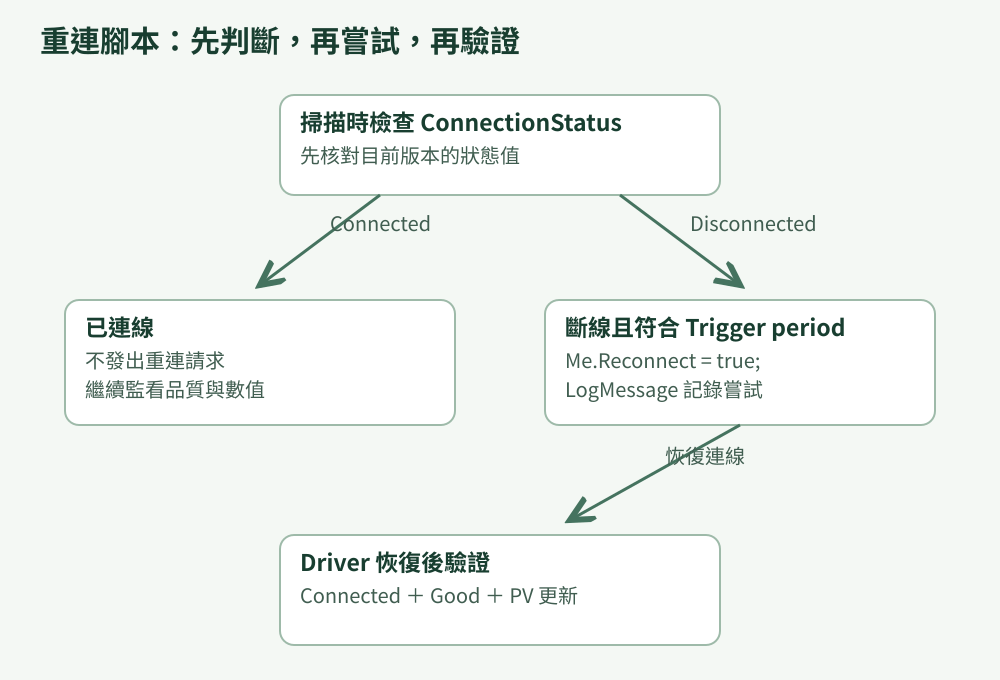

# 自動重連與日誌

基礎 / platform

## 學習目標
- 能用自己的話說明「自動重連與日誌」的主要角色或資料關係。
- 能辨認本課常見誤解，並說明應查驗的資料或證據。

## 前置能力
先理解 FMCS 的資料流與監控分工。

## 原教材重點
- 此腳本取自內部教材。ConnectionStatus 的數值對應與 Reconnect 屬性，應先於目前版本 Object Viewer 與說明文件核對。
- 在測試 _002_P 新增 Reconnect 腳本。
- 教材條件 Me.ConnectionStatus <> 2；先確認 2 在本機代表 Connected。
- Trigger type WhileTrue，Trigger period 00:00:05，Execution type Execute。
- 程式內容：Me.Reconnect = true; 及 LogMessage("=====Reconnecting=====");。
- Check-in、Deploy；測試 Driver Deactivate，觀察狀態與每五秒日誌。
- 重新 Activate，確認 Connected、Good 品質與 PV 更新；持續重連則回查根因。
- WhileTrue 是條件成立時週期執行；不等同資料變更事件。
- 只有日誌卻未恢復？確認 Driver 已啟動、網路可達、授權正常；重連腳本無法修正錯誤位址或安全設定。

## 圖文對照

原教材流程示意，非實際軟體截圖。

## 常見問題
### 這一課應先掌握什麼？
此腳本取自內部教材。ConnectionStatus 的數值對應與 Reconnect 屬性，應先於目前版本 Object Viewer 與說明文件核對。

### QuickScript .NET 與 C# 的觀念可如何對照？
可借用變數與條件觀念，但仍核對實際語法。概念相通不等於語法、執行環境與生命週期相同。

### 腳本中的 Me 通常用來參照什麼？
目前物件的成員。Me 的作用需放在目前物件與腳本執行環境中理解。

## 記憶卡
- 問：在掃描腳本內做長時間外部查詢，主要風險為何？
  答：阻塞掃描並影響其他工作。外部延遲會影響執行節奏，需規劃逾時與責任邊界。
- 問：衍生狀態計算前，應先檢查什麼？
  答：來源品質及輸入是否符合前提。無效輸入可能產生看似合理但錯誤的衍生結果。
- 問：腳本排錯時，哪種日誌較有幫助？
  答：含時間、物件、條件與結果的紀錄。有上下文且控制頻率的日誌，才便於還原事件。

## 實作與學習紀錄
以本課原教材的案例，記錄一項正常情境與一項異常情境，分別寫下預期結果、實際證據及待確認事項。

- 我的說明：
- 預期與實際結果：
- 待確認問題：

## 課後五題測驗

1. 下列哪項符合本課的教材重點？
   A. 此腳本取自內部教材。ConnectionStatus 的數值對應與 Reconnect 屬性，應先於目前版本 Object Viewer 與說明文件核對。
   B. 所有 C# 程式碼都能原樣貼入
   C. 只要副檔名相同就可執行

2. 複習本課的操作與判讀原則，哪一項正確？
   A. 在測試 _002_P 新增 Reconnect 腳本。
   B. 任意一台遠端 PLC
   C. 所有使用者帳號

3. QuickScript .NET 與 C# 的觀念可如何對照？
   A. 可借用變數與條件觀念，但仍核對實際語法
   B. 只要副檔名相同就可執行
   C. 所有 C# 程式碼都能原樣貼入

4. 腳本中的 Me 通常用來參照什麼？
   A. 目前物件的成員
   B. 任意一台遠端 PLC
   C. 所有使用者帳號

5. 腳本排錯時，哪種日誌較有幫助？
   A. 含時間、物件、條件與結果的紀錄
   B. 每次只寫「失敗」
   C. 無限制重複同一行直到磁碟滿

## 答案與解析
1. A：本課原教材重點：此腳本取自內部教材。ConnectionStatus 的數值對應與 Reconnect 屬性，應先於目前版本 Object Viewer 與說明文件核對。
2. A：本課原教材重點：在測試 _002_P 新增 Reconnect 腳本。
3. A：概念相通不等於語法、執行環境與生命週期相同。
4. A：Me 的作用需放在目前物件與腳本執行環境中理解。
5. A：有上下文且控制頻率的日誌，才便於還原事件。

## 原教材
https://chermanyen.github.io/fmcs-academy/courses/platform/index.html#script
概念與練習沿用本站原教材；版本、來源圖及限制仍以原教材標示為準。
