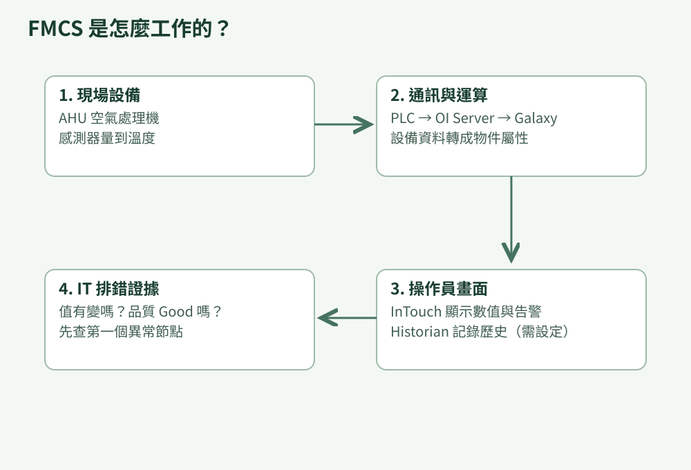

# 認識 FMCS 與學習環境

基礎 / platform

## 學習目標
- 能用自己的話說明「認識 FMCS 與學習環境」的主要角色或資料關係。
- 能辨認本課常見誤解，並說明應查驗的資料或證據。

## 前置能力
先理解 FMCS 的資料流與監控分工。

## 原教材重點
- FMCS 是廠務監控系統，將空調、電力、用水等設備資料集中顯示、告警與追蹤。你熟悉的資料庫、服務與網路，都是排錯的重要基礎。
- 確認測試主機為 Windows Server 2022，記錄 System Platform 2023 R2 SP1 P03 與 SQL Server 版本。
- 在獨立測試環境操作，先備份 Galaxy；記錄主機名稱、授權及登入權限。
- 開啟 System Platform IDE，確認可連接測試 Galaxy。
- 開啟 OCMC，找到 Log Viewer；確認 AVEVA Agent (Watchdog) 服務狀態。
- Galaxy 像專案資料庫；IDE 像 Visual Studio；AppEngine 像執行物件邏輯的服務。
- 開始前無法連線？先記錄完整錯誤，再檢查 SQL 服務、主機解析、權限與 AVEVA 日誌。

## 圖文對照

原教材流程示意，非實際軟體截圖。

## 常見問題
### 這一課應先掌握什麼？
FMCS 是廠務監控系統，將空調、電力、用水等設備資料集中顯示、告警與追蹤。你熟悉的資料庫、服務與網路，都是排錯的重要基礎。

### 建立測試環境前，先盤點什麼？
作業系統、產品版本、SQL、授權與網路需求。環境基線有助於核對相容性與重現問題。

### 教材畫面與安裝版本不同時，應怎麼辦？
對照安裝版本 Help 與正式文件。欄位位置與功能可能隨版本不同，應以實際版本資料為準。

## 記憶卡
- 問：VM 快照與資料庫備份可以完全互相取代嗎？
  答：需分清各自保護範圍與還原程序。兩者層次不同，還原一致性與支援方式要依環境規劃。
- 問：測試環境為何要與生產操作分開？
  答：便於安全地重現、回復及驗證變更。隔離環境可降低練習與排錯對正式運作的干擾。
- 問：版本盤點表對交接有何幫助？
  答：讓接手人確認相容性及驗證前提。基線描述環境前提，但實際行為仍需驗證。

## 實作與學習紀錄
以本課原教材的案例，記錄一項正常情境與一項異常情境，分別寫下預期結果、實際證據及待確認事項。

- 我的說明：
- 預期與實際結果：
- 待確認問題：

## 課後五題測驗

1. 下列哪項符合本課的教材重點？
   A. 只看電腦外殼品牌
   B. FMCS 是廠務監控系統，將空調、電力、用水等設備資料集中顯示、告警與追蹤。你熟悉的資料庫、服務與網路，都是排錯的重要基礎。
   C. 任選版本後再碰運氣

2. 複習本課的操作與判讀原則，哪一項正確？
   A. 直接認定教材畫面就是現場
   B. 確認測試主機為 Windows Server 2022，記錄 System Platform 2023 R2 SP1 P03 與 SQL Server 版本。
   C. 任意套用所有舊參數

3. VM 快照與資料庫備份可以完全互相取代嗎？
   A. 有快照就不需考慮資料庫
   B. 需分清各自保護範圍與還原程序
   C. 兩者永遠完全相同

4. 版本盤點表對交接有何幫助？
   A. 讓接手人確認相容性及驗證前提
   B. 能保證永不故障
   C. 可以代替所有操作驗收

5. 教材畫面與安裝版本不同時，應怎麼辦？
   A. 對照安裝版本 Help 與正式文件
   B. 任意套用所有舊參數
   C. 直接認定教材畫面就是現場

## 答案與解析
1. B：本課原教材重點：FMCS 是廠務監控系統，將空調、電力、用水等設備資料集中顯示、告警與追蹤。你熟悉的資料庫、服務與網路，都是排錯的重要基礎。
2. B：本課原教材重點：確認測試主機為 Windows Server 2022，記錄 System Platform 2023 R2 SP1 P03 與 SQL Server 版本。
3. B：兩者層次不同，還原一致性與支援方式要依環境規劃。
4. A：基線描述環境前提，但實際行為仍需驗證。
5. A：欄位位置與功能可能隨版本不同，應以實際版本資料為準。

## 原教材
https://chermanyen.github.io/fmcs-academy/courses/platform/index.html#start
概念與練習沿用本站原教材；版本、來源圖及限制仍以原教材標示為準。
