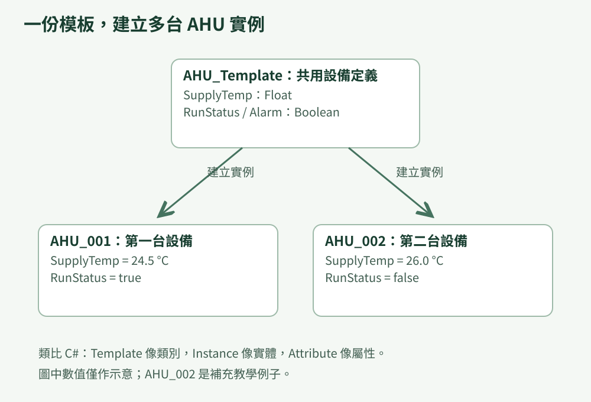

# 建立 AHU_Template 與 AHU_001

基礎 / platform

## 學習目標
- 能用自己的話說明「建立 AHU_Template 與 AHU_001」的主要角色或資料關係。
- 能辨認本課常見誤解，並說明應查驗的資料或證據。

## 前置能力
先理解 FMCS 的資料流與監控分工。

## 原教材重點
- AHU 是空氣處理機。Template 可類比 C# 類別，Instance 類比實體，Attribute 類比屬性。此 AHU 命名與欄位為教學設計，須由宇辰專案負責人確認正式規範。
- 從 $UserDefined 衍生模板，使用 IDE 允許的名稱 AHU_Template（模板可能以 $ 顯示）。
- 新增 SupplyTemp（Float）、RunStatus（Boolean）、Alarm（Boolean）。
- SupplyTemp 設工程單位 °C；此階段只做測試值，不連現場 I/O。
- Save、Check-in，從模板建立 AHU_001，指派測試 Area 與 AppEngine。
- Deploy 後用 Object Viewer 觀察 AHU_001.SupplyTemp；修改模板前先評估衍生物件影響。
- AHU_001.SupplyTemp 是物件名稱加屬性名稱，類似物件的屬性存取。
- 無法編輯？檢查是否已 Check-out、權限是否足夠、屬性是否由模板鎖定。

## 圖文對照

原教材流程示意，非實際軟體截圖。

## 常見問題
### 這一課應先掌握什麼？
AHU 是空氣處理機。Template 可類比 C# 類別，Instance 類比實體，Attribute 類比屬性。此 AHU 命名與欄位為教學設計，須由宇辰專案負責人確認正式規範。

### Template 與 Instance 的關係為何？
範本定義共用規格，實例代表具體設備。共用結構可重用，具體設備仍保有自己的來源與狀態。

### 兩台設備共用範本，哪些內容通常仍須分開確認？
設備來源與專屬參數。範本重用不代表把不同設備的資料合併。

## 記憶卡
- 問：修改共用範本前，應先確認什麼？
  答：衍生實例的影響範圍與測試方式。共用規格可能影響多個實例，變更需先盤點與驗證。
- 問：Attribute 在設備物件中表示什麼？
  答：一項資料欄位或狀態屬性。Attribute 承載設備的數值、狀態或設定，其型別與來源需明確。
- 問：建立可維護的設備範本，較好的原則為何？
  答：共通規格集中，個別差異明確。共用與差異分清可減少重複維護及映射錯誤。

## 實作與學習紀錄
以本課原教材的案例，記錄一項正常情境與一項異常情境，分別寫下預期結果、實際證據及待確認事項。

- 我的說明：
- 預期與實際結果：
- 待確認問題：

## 課後五題測驗

1. 下列哪項符合本課的教材重點？
   A. AHU 是空氣處理機。Template 可類比 C# 類別，Instance 類比實體，Attribute 類比屬性。此 AHU 命名與欄位為教學設計，須由宇辰專案負責人確認正式規範。
   B. 實例只能有一個固定值
   C. 兩者都是同一台實體 PLC

2. 複習本課的操作與判讀原則，哪一項正確？
   A. 兩台永遠共用一個來源
   B. 從 $UserDefined 衍生模板，使用 IDE 允許的名稱 AHU_Template（模板可能以 $ 顯示）。
   C. 只需改中文名稱

3. 兩台設備共用範本，哪些內容通常仍須分開確認？
   A. 設備來源與專屬參數
   B. 只需改中文名稱
   C. 兩台永遠共用一個來源

4. Template 與 Instance 的關係為何？
   A. 實例只能有一個固定值
   B. 兩者都是同一台實體 PLC
   C. 範本定義共用規格，實例代表具體設備

5. 修改共用範本前，應先確認什麼？
   A. 衍生實例的影響範圍與測試方式
   B. 只要單台畫面正常即可
   C. 直接修改全部生產設備

## 答案與解析
1. A：本課原教材重點：AHU 是空氣處理機。Template 可類比 C# 類別，Instance 類比實體，Attribute 類比屬性。此 AHU 命名與欄位為教學設計，須由宇辰專案負責人確認正式規範。
2. B：本課原教材重點：從 $UserDefined 衍生模板，使用 IDE 允許的名稱 AHU_Template（模板可能以 $ 顯示）。
3. A：範本重用不代表把不同設備的資料合併。
4. C：共用結構可重用，具體設備仍保有自己的來源與狀態。
5. A：共用規格可能影響多個實例，變更需先盤點與驗證。

## 原教材
https://chermanyen.github.io/fmcs-academy/courses/platform/index.html#template
概念與練習沿用本站原教材；版本、來源圖及限制仍以原教材標示為準。
