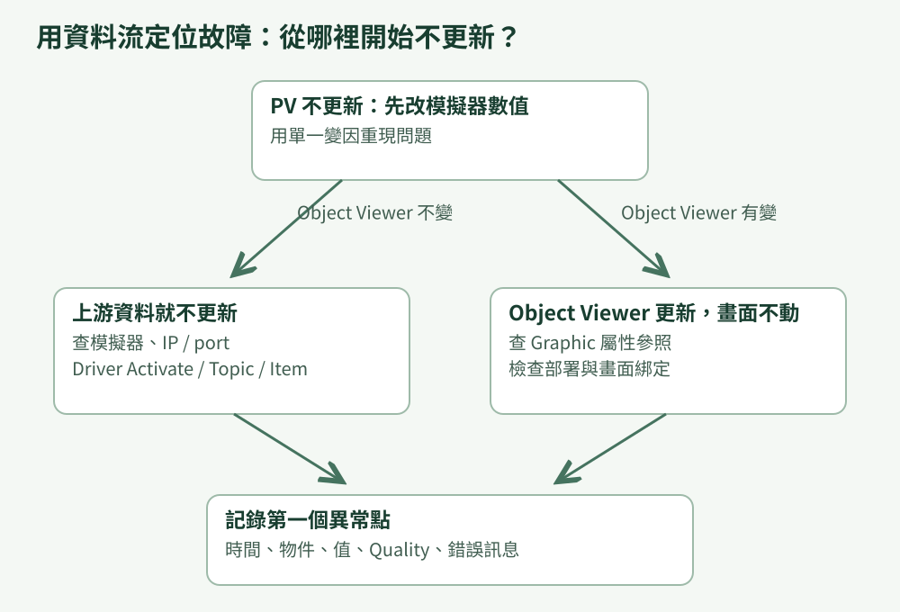

# 故障排除與交接

基礎 / platform

## 學習目標
- 能用自己的話說明「故障排除與交接」的主要角色或資料關係。
- 能辨認本課常見誤解，並說明應查驗的資料或證據。

## 前置能力
先理解 FMCS 的資料流與監控分工。

## 原教材重點
- 建立可重現的問題紀錄：時間、版本、物件、錯誤訊息、預期結果、實際結果與已做動作。
- PV 不動：先改模擬器，確認 OCMC 更新，再查 DI、物件品質、畫面參照。
- Watchdog 啟動逾時：查 Windows 事件 7000／7009 及 AVEVA 日誌，記錄相依服務狀態。
- 唯讀查看 Get-Service -Name Watchdog_Service，不以 Running 當作整個系統正常的證明。
- 改名或重新指派 I/O 前依內部流程 Undeploy；改後 Save、Check-in、Deploy。
- 交接前備份 Galaxy、記錄版本與命名，保留故障前後日誌與驗證結果。
- Log Viewer 提供 AVEVA 診斷訊息；Windows Event Viewer 補充作業系統及服務事件。
- 本教材不提供未經確認的正式主機位址、帳密或寫入現場設備操作。內部 SOP 仍需主管審核。

## 圖文對照

原教材流程示意，非實際軟體截圖。

## 常見問題
### 這一課應先掌握什麼？
建立可重現的問題紀錄：時間、版本、物件、錯誤訊息、預期結果、實際結果與已做動作。

### 故障排除較好的起點為何？
記錄時間、範圍、物件與完整錯誤。證據可建立故障前後的關係，避免盲目變更。

### 只有一台設備值錯，應優先如何縮小範圍？
與正常設備比對來源及映射差異。以正常基線做比較可快速找出局部設定差異。

## 記憶卡
- 問：來源、平台與畫面分層核對有何價值？
  答：找到最早出現差異的位置。故障可能出在任一層，分層證據讓下一步更具體。
- 問：排錯變更一次最好怎麼安排？
  答：記錄一項變更及其驗證結果。可追溯的單項變更更容易判斷因果及回復。
- 問：交接故障問題時，應提供什麼？
  答：預期、實際、重現步驟與已做檢查。完整上下文能讓接手人延續調查而非從頭猜測。

## 實作與學習紀錄
以本課原教材的案例，記錄一項正常情境與一項異常情境，分別寫下預期結果、實際證據及待確認事項。

- 我的說明：
- 預期與實際結果：
- 待確認問題：

## 課後五題測驗

1. 下列哪項符合本課的教材重點？
   A. 立即改掉所有設定
   B. 先刪除日誌
   C. 建立可重現的問題紀錄：時間、版本、物件、錯誤訊息、預期結果、實際結果與已做動作。

2. 複習本課的操作與判讀原則，哪一項正確？
   A. PV 不動：先改模擬器，確認 OCMC 更新，再查 DI、物件品質、畫面參照。
   B. 先停用所有警報
   C. 重裝整個廠區系統

3. 只有一台設備值錯，應優先如何縮小範圍？
   A. 重裝整個廠區系統
   B. 先停用所有警報
   C. 與正常設備比對來源及映射差異

4. 故障排除較好的起點為何？
   A. 先刪除日誌
   B. 立即改掉所有設定
   C. 記錄時間、範圍、物件與完整錯誤

5. 排錯變更一次最好怎麼安排？
   A. 只要有改善就不記錄
   B. 同時改所有參數以節省時間
   C. 記錄一項變更及其驗證結果

## 答案與解析
1. C：本課原教材重點：建立可重現的問題紀錄：時間、版本、物件、錯誤訊息、預期結果、實際結果與已做動作。
2. A：本課原教材重點：PV 不動：先改模擬器，確認 OCMC 更新，再查 DI、物件品質、畫面參照。
3. C：以正常基線做比較可快速找出局部設定差異。
4. C：證據可建立故障前後的關係，避免盲目變更。
5. C：可追溯的單項變更更容易判斷因果及回復。

## 原教材
https://chermanyen.github.io/fmcs-academy/courses/platform/index.html#trouble
概念與練習沿用本站原教材；版本、來源圖及限制仍以原教材標示為準。
